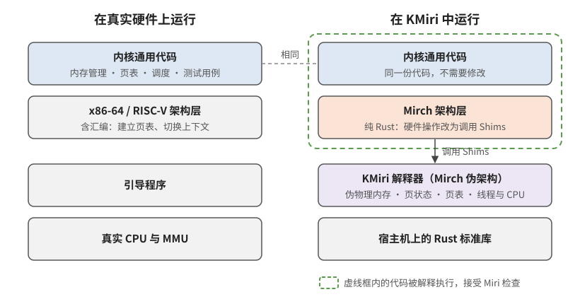
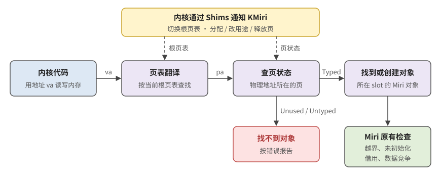
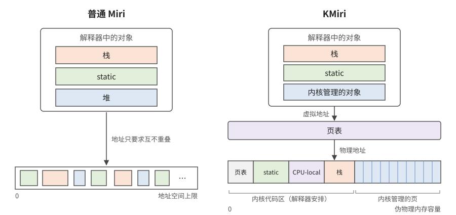
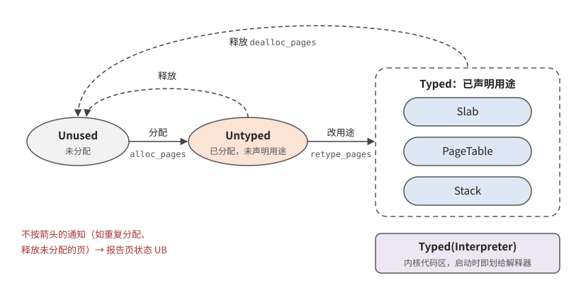
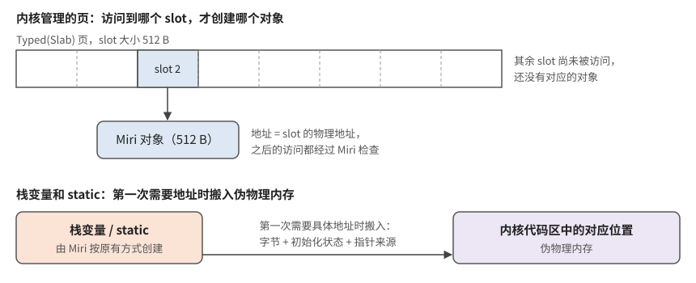
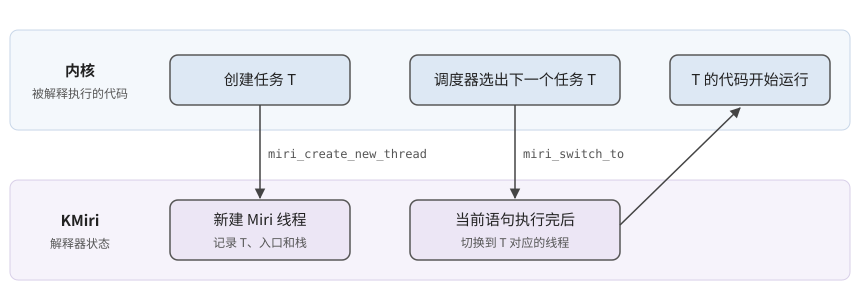
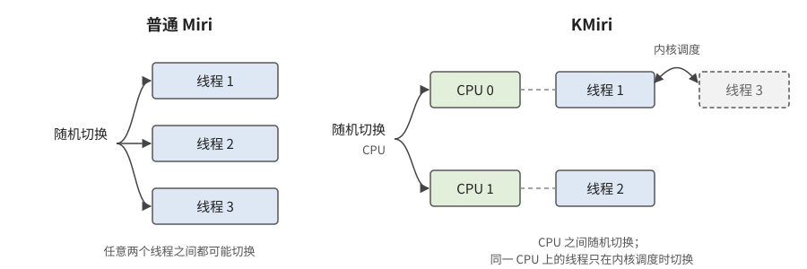

# 核心设计

本章说明 KMiri 怎样让 Miri 理解内核自己管理的内存和执行过程。阅读前只需了解两点：Miri 通过解释执行 MIR 来检查 Rust 中的未定义行为；它原本假设被检查的是普通用户态程序（见[引言](intro.md#r-intro.background)）。各节末尾的“当前实现情况”以[适配路线图](overview.md#r-overview.adaptation)中固定的源码版本为准。

## 设计思路：把 KMiri 当作一种 CPU 架构

r[core.approach]

普通 Miri 跑不了内核，根本原因是内核要直接操作硬件：建立页表，在指定的物理页上存放数据，自己切换线程的栈。在真实机器上，这些事情靠汇编和 CPU 完成；Miri 不能解释汇编，也没有“物理内存”“页表”“CPU”这些概念。

Rust 内核本来就要支持多种 CPU 架构，通常把与硬件相关的代码集中在架构层（如 `arch/x86`、`arch/riscv`）。KMiri 利用了这一点：它定义了一种只存在于解释器中的伪架构 **Mirch**，内核像移植到新架构一样，为 Mirch 写一个架构层。与真实架构不同，这个架构层完全用 Rust 编写，原本要靠汇编完成的硬件操作，改为调用 KMiri 提供的接口（Shims）。

这样一来，架构层以外的内核代码（内存管理、页表管理、调度器等）不需要修改，而且整个内核都在 Miri 中运行，都受 Miri 检查。代价是每个内核要写一个 Mirch 架构层。星绽已有这样的架构层；TockOS 和 BlueOS 的接入方式更轻，见[适配路线图](overview.md#r-overview.adaptation)。

Mirch 需要替代真实硬件提供几项能力，下表也是本章其余各节的顺序：

| 内核要做的事 | 普通 Miri 缺什么 | KMiri 的设计 |
| --- | --- | --- |
| 按物理地址管理内存 | 对象地址由解释器随意分配，没有“物理内存” | [伪物理内存](#r-core.memory)：预留一块内存作为物理内存 |
| 分配页、决定页的用途、回收页 | 不知道一页现在能不能用、用来存什么 | [页状态跟踪](#r-core.page-state)：为每页记录状态，由内核通知变化 |
| 用页表把虚拟地址映射到物理地址 | 只有一种地址，没有翻译这一步 | [页表模型](#r-core.page-table)：按内核设置的页表翻译地址 |
| 在自己管理的页上创建对象 | 对象只能由 Rust 运行时创建 | [地址感知的分配](#r-core.allocation)：在页上按需创建 Miri 对象 |
| 创建线程并在线程间切换 | 只认识 pthread 这类用户态接口 | [内核线程模型](#r-core.thread)：内核通知创建与切换 |
| 在多个 CPU 上运行、使用 CPU-local 数据 | 没有 CPU 的概念 | [SMP 与 CPU-Local](#r-core.smp)：模拟多个 CPU |

内核需要通知 KMiri 的全部接口汇总在 [Shims API](#r-core.shims) 一节。

这些设计合在一起，决定了内核用一个地址访问内存时会发生什么：

KMiri 先按当前页表把虚拟地址翻译成物理地址，再查这一页的状态。只有被内核声明了用途（Typed）的页上才有 Rust 对象：访问落到具体对象后，继续接受 Miri 原有的越界、未初始化、借用和数据竞争检查。如果这一页还没分配、已经释放，或者还没声明用途，就找不到对象，访问按错误报告。根页表和页状态都由内核通过 Shims 告诉 KMiri。

## 伪物理内存（Pseudo Physical Memory）

r[core.memory]

在普通 Miri 中，栈变量、static 和堆对象都是解释器内部的对象（`Allocation`）。它们的地址由 Miri 分配，只保证彼此不重叠，因为用户态程序不关心对象具体在哪个地址。内核则不同：它把内存看作一段按物理地址编号的页，自己决定哪一页放页表、哪一页给 slab 分配器，并且直接拿地址访问。地址没有真实含义，内核的这些操作就无从执行。

所以 KMiri 在解释器里预留一块连续内存，作为内核看到的“物理内存”，物理地址就是在这块内存中的偏移。它分成两部分（下图右侧）：

* **内核代码区**：存放 Rust 运行时自动创建的对象，即 static、CPU-local 变量和栈，另有一张启动页表。内核把自身镜像当作一个整体，不逐个管理其中对象的位置，所以这一部分由解释器安排。
* **内核管理的页**：其余的页全部交给内核自己的页分配器。

KMiri 没有改写 Miri 访问对象、检查 UB 的逻辑，只改了两件事：对象的地址从哪里来（必须落在伪物理内存里），以及谁能创建对象（除了 Rust 运行时，内核也能在自己管理的页上创建，见[地址感知的分配](#r-core.allocation)）。因此 Miri 原有的检查继续有效。

伪物理内存的大小、内核代码区的划分，以及内核代码区映射到的虚拟地址，都可以在配置文件中调整，以适应不同内核的地址布局。

### 当前实现情况

页大小固定为 4 KiB。不使用页表的内核（如 TockOS）可以在配置中关闭分页，此时虚拟地址就等于物理地址，KMiri 也不维护下一节的页状态，这类内核因此得不到页状态检查。

相关源码

* [默认配置](https://github.com/KMiri-rs/miri/blob/af87bdb338e347872bc2429308e2865901488bfb/src/mirch/config.rs#L97-L117)、[配置文件字段](https://github.com/KMiri-rs/miri/blob/af87bdb338e347872bc2429308e2865901488bfb/src/mirch/config_toml.rs#L8-L36)、[TockOS 的配置](https://github.com/KMiri-rs/tock/blob/b07f8a811d7fc6317f6a77ea0b066d8ecf80134c/boards/qemu_rv64_virt/kmiri.toml#L1-L20)
* [伪物理内存初始化](https://github.com/KMiri-rs/miri/blob/af87bdb338e347872bc2429308e2865901488bfb/src/mirch/physical_mem.rs#L414-L435)

## 页状态跟踪（Page State Tracking）

r[core.page-state]

真实硬件不关心一页内存是否已经分配、用来做什么，只要地址有效就允许读写。而内核中很多环境级 UB 恰恰出在这里：使用已经释放的页，把同一页同时当作两种东西用，或者把还没准备好的页当成页表。所以 KMiri 给每一页附加一个真实硬件上没有的状态，并要求内核在改变页的用途时告诉解释器。

* **Unused**：未分配。
* **Untyped**：已分配，但还没说明里面放什么。内核拿到页后可以先清零或按字节写入，但还不能当作 Rust 对象来用。
* **Typed**：已声明用途。改用途时内核同时给出 *slot 大小*，决定这一页怎样切成 Rust 对象：例如给 slab 分配器的页按对象大小切分，页表页按 8 字节（一个页表项）切分。每个 slot 对应一个 Miri 对象。目前的用途有 Slab、PageTable 和 Stack。
* **Typed(Interpreter)**：标记内核代码区。这块区域在启动时就交给解释器，内核不能分配或释放。

状态只能沿图中箭头转换：分配要求页处于 Unused，改用途要求页处于 Untyped，释放把 Untyped 或 Typed 页变回 Unused，并删除页上的所有对象。不符合的通知（例如重复分配同一页、释放未分配的页）报告为页状态 UB，报告中给出物理地址、页号以及期望和实际的状态。

有了页状态，整页的释放后使用也能被发现：页释放后，页上的对象随之删除，之后再用旧地址访问就找不到对象。

Untyped 页上没有 Rust 对象，内核要用专门的接口读写它（如 `kern_miri_copy_untyped`）。复制时解释器检查两端都是 Untyped 页，并连同“哪些字节已初始化”一起复制，不会因为一次复制就把未初始化的数据当成已初始化。

### 当前实现情况

* 星绽的页分配器、slab 和页表页已经发出分配和改用途的通知，但普通物理页和连续段的释放通知还不完整（修复见 [asterinas#27](https://github.com/KMiri-rs/asterinas/pull/27)，尚未合并）。在这之前，这些页被内核释放后，KMiri 仍认为它们处于已分配状态，相关的释放后使用不会被发现。
* 原设计中按 1、2、4、8 字节读写 Untyped 页的接口（`kern_miri_read_u8_untyped` 等）尚未在解释器中实现，目前只有复制、清零和写入字节。

相关源码

* [页状态定义](https://github.com/KMiri-rs/miri/blob/af87bdb338e347872bc2429308e2865901488bfb/src/mirch/physical_mem.rs#L461-L498)、[状态检查与报错](https://github.com/KMiri-rs/miri/blob/af87bdb338e347872bc2429308e2865901488bfb/src/mirch/physical_mem.rs#L337-L353)、[释放时的清理](https://github.com/KMiri-rs/miri/blob/af87bdb338e347872bc2429308e2865901488bfb/src/mirch/physical_mem.rs#L135-L173)
* [分配 / 释放 / 改用途入口](https://github.com/KMiri-rs/miri/blob/af87bdb338e347872bc2429308e2865901488bfb/src/shims/foreign_items.rs#L906-L969)、[Untyped 复制](https://github.com/KMiri-rs/miri/blob/af87bdb338e347872bc2429308e2865901488bfb/src/mirch/physical_mem.rs#L197-L295)
* 星绽调用：[页分配](https://github.com/KMiri-rs/asterinas/blob/e255c1ed5550dc2965c535c824f17f9f353fc31e/ostd/src/mm/frame/allocator.rs#L53-L76)、[slab 改用途](https://github.com/KMiri-rs/asterinas/blob/e255c1ed5550dc2965c535c824f17f9f353fc31e/ostd/src/mm/heap/slab.rs#L104-L119)、[页表页改用途](https://github.com/KMiri-rs/asterinas/blob/e255c1ed5550dc2965c535c824f17f9f353fc31e/ostd/src/mm/page_table/node/mod.rs#L72-L87)
* 测试：[重复分配](https://github.com/KMiri-rs/KMiri/blob/33963c7ebde744f52657d4205b39e42a9bbefd23/tests/ub-page-state/src/lib.rs#L7-L20)、[复制未初始化数据](https://github.com/KMiri-rs/miri/blob/af87bdb338e347872bc2429308e2865901488bfb/tests/fail/kmiri/physical-copy-uninitialized.rs#L1-L33)、[复制已初始化数据](https://github.com/KMiri-rs/miri/blob/af87bdb338e347872bc2429308e2865901488bfb/tests/pass/kmiri/physical-copy-initialized.rs#L1-L34)

## 页表模型（Page Table Model）

r[core.page-table]

内核用页表决定一个虚拟地址对应哪个物理地址：同一个物理页可以有多个虚拟地址，映射也会随时改变。普通 Miri 只有一种地址，没有翻译这一步。如果 KMiri 不模拟页表，内核把页映射错了，或者映射到了不该映射的页，解释器都察觉不到。

**页表格式。** Mirch 作为一种架构，规定了自己的页表格式：4 级页表，每项 8 字节，页大小 4 KiB。这与常见的 64 位架构一致，内核原有的页表代码基本可以直接复用。内核创建页表页、填写页表项的代码都作为普通 Rust 代码被解释执行，并接受检查。

**根页表。** 真实 CPU 用一个寄存器保存当前页表的根地址（如 x86 的 CR3）。Mirch 用两个接口代替这个寄存器：内核切换页表时调用 `kern_miri_set_root_page_table`，需要读取时调用 `kern_miri_get_root_page_table`。

**启动页表。** 内核启动初期通常用汇编建一张临时页表，之后才进入 Rust 代码。KMiri 无法执行这段汇编，所以在开始解释前替内核建好一张启动页表：映射内核代码区，并提供一段线性映射供早期初始化使用。之后内核建立并切换到自己的完整页表。

**地址翻译。** 内核把一个整数地址当作指针使用时（例如由物理地址换算出虚拟地址再访问），KMiri 按当前根页表逐级查找，得到物理地址，再进入页状态和对象查找（见[本章开头的访问过程图](#r-core.approach)）。

### 当前实现情况

页表目前只完成了地址翻译。下面几项尚未实现，相应的错误目前不会被报告：

* **不检查读写权限。** Mirch 设计中页表项有可读、可写位，但当前翻译只看“映射有效”和“大页”两位。通过只读映射写入目前不会报错。
* **翻译失败时不报错。** 当前页表查不到映射时，KMiri 会改按内核代码区或启动线性映射的固定偏移计算物理地址，而不是报告访问了未映射的地址。这可能把错误的访问当作合法访问，属于待修复的缺口。
* **映射一致性检查。** 设计目标是在内核修改页表后，检查是否出现了不该有的映射，例如 Typed 页被映射到用户空间，或同一个内核对象有两个内核虚拟地址。目前 KMiri 已经能察觉页表页被写入，但写入后的检查还是空的。
* **不模拟 TLB。** 真实 CPU 会缓存地址翻译结果，内核修改页表后必须刷新。KMiri 总是按页表的当前内容翻译，相当于缓存永远是最新的，所以“改了页表却忘记刷新 TLB”这类错误无法发现。
* **只有一个全局的根页表**，还不支持每个 CPU 使用不同的根页表。

相关源码

* [启动页表与地址翻译](https://github.com/KMiri-rs/miri/blob/af87bdb338e347872bc2429308e2865901488bfb/src/mirch/page_table.rs#L7-L162)、[翻译失败时的回退](https://github.com/KMiri-rs/miri/blob/af87bdb338e347872bc2429308e2865901488bfb/src/alloc_addresses/mod.rs#L425-L454)
* [设置 / 读取根页表](https://github.com/KMiri-rs/miri/blob/af87bdb338e347872bc2429308e2865901488bfb/src/shims/foreign_items.rs#L970-L978) → [星绽调用](https://github.com/KMiri-rs/asterinas/blob/e255c1ed5550dc2965c535c824f17f9f353fc31e/ostd/src/arch/miri/mm/mod.rs#L113-L139)
* [页表页写入的标记](https://github.com/KMiri-rs/miri/blob/af87bdb338e347872bc2429308e2865901488bfb/src/machine.rs#L1844-L1853)、[尚未实现的检查](https://github.com/KMiri-rs/miri/blob/af87bdb338e347872bc2429308e2865901488bfb/src/concurrency/scheduler.rs#L206-L219)、[星绽 TLB 刷新（空操作）](https://github.com/KMiri-rs/asterinas/blob/e255c1ed5550dc2965c535c824f17f9f353fc31e/ostd/src/arch/miri/mm/mod.rs#L78-L95)

## 地址感知的分配（Address-Aware Allocation）

r[core.allocation]

有了伪物理内存，就必须保证 Miri 中的每个对象都确实“住”在这块内存里，对象的字节就是伪物理内存对应位置的字节。否则会出现两份数据。例如内核用 `ptr::copy` 按地址把栈上的数组复制到某个页，如果这个数组的字节实际存在 Miri 自己的存储里，伪物理内存中那个地址就是空的，复制结果就是错的。

对象有两个来源，处理方式不同：

**内核在页上创建的对象。** 内核把页改为 Typed 时已经给出了 slot 大小。KMiri 并不立即为每个 slot 创建对象，而是在某个 slot 第一次被访问时，才创建一个与 slot 同样大小的 Miri 对象，地址就是该 slot 的物理地址。这样内核的分配器不需要每分配一个对象就通知一次，而之后对这个对象的访问都会接受 Miri 检查。页被释放时，页上的这些对象一起删除。

**Rust 运行时创建的对象，即栈变量和 static。** 它们仍由 Miri 按原有方式创建，KMiri 在它们第一次需要具体地址时，把它们搬到内核代码区中的对应位置。搬的不只是字节，还有“哪些字节已初始化”和“字节中的指针来自哪个对象”这两类信息，这样 Miri 之后的检查结果不受影响。

**栈空间回收。** 内核代码区大小有限。普通 Miri 不关心栈变量的地址会不会被重复使用，但在 KMiri 中，如果函数返回后不回收它用过的栈地址，地址很快就会耗尽。所以 KMiri 为每个线程记录栈地址用到了哪里：调用函数时记下当前位置，函数返回或展开时恢复，同时删除该函数的栈对象。

### 当前实现情况

* slot 在改用途时就固定下来，对象只在整页释放时删除。真实的 slab 分配器会在一页中反复分配和释放单个对象，所以“页还在，但其中某个对象已被分配器回收”之后的访问，目前还不能识别为释放后使用。
* 跨越多页的对象，其初始化状态还没有正确继承（源码中有 FIXME）。

相关源码

* [按 slot 创建对象](https://github.com/KMiri-rs/miri/blob/af87bdb338e347872bc2429308e2865901488bfb/src/alloc_addresses/mod.rs#L365-L420)、[在指定地址建立对象](https://github.com/KMiri-rs/miri/blob/af87bdb338e347872bc2429308e2865901488bfb/src/mirch/physical_mem.rs#L52-L84)
* [栈对象搬迁](https://github.com/KMiri-rs/miri/blob/af87bdb338e347872bc2429308e2865901488bfb/src/alloc_addresses/mod.rs#L678-L751)、[static 搬迁](https://github.com/KMiri-rs/miri/blob/af87bdb338e347872bc2429308e2865901488bfb/src/machine.rs#L1719-L1767)
* [调用时记录栈位置](https://github.com/KMiri-rs/miri/blob/af87bdb338e347872bc2429308e2865901488bfb/src/machine.rs#L2080-L2096)、[返回时恢复](https://github.com/KMiri-rs/miri/blob/af87bdb338e347872bc2429308e2865901488bfb/src/machine.rs#L2138-L2185)、[删除对象](https://github.com/KMiri-rs/miri/blob/af87bdb338e347872bc2429308e2865901488bfb/src/alloc_addresses/mod.rs#L866-L905)

## 内核线程模型（Kernel Thread Model）

r[core.thread]

普通 Miri 也支持多线程，但线程是通过模拟 pthread 这类操作系统接口创建的。内核没有这些接口，因为它自己就是实现线程的一方：自己分配栈、保存上下文，由调度器决定下一个运行哪个任务。其中上下文切换通常用汇编写成，Miri 无法执行。

KMiri 让内核在两个时刻通知解释器，调度决策仍然完全由内核做出：

* **创建任务时**，内核调用 `miri_create_new_thread`，传入任务、入口函数以及栈的位置和大小。KMiri 新建一个 Miri 线程，并记住它对应哪个任务。
* **调度器决定切换时**，内核调用 `miri_switch_to` 并传入目标任务，代替原来的汇编上下文切换。KMiri 等当前这条 MIR 语句执行完，再把正在执行的线程换成目标任务的线程。

由于调度决策来自内核自己的调度器，调度器代码本身也被解释执行、接受检查，KMiri 也不必为每个内核各写一套调度逻辑。

**栈。** 每个线程有独立的栈地址范围。内核通常自己为任务分配栈页，这时直接把范围告诉 KMiri；内核不提供时，由 KMiri 在内核代码区中分配。函数的局部变量仍由 Miri 按 MIR 创建，只是地址落在该线程的栈范围内（回收方式见[栈空间回收](#r-core.allocation)）。KMiri 不模拟汇编层面的栈帧布局。

### 当前实现情况

星绽已接入任务的创建与切换，[init 用例](https://github.com/KMiri-rs/KMiri/blob/33963c7ebde744f52657d4205b39e42a9bbefd23/tests/init/src/lib.rs#L7-L19)包含任务创建和让出 CPU。任务被切换进来后的收尾工作，以及任务退出后对应的 Miri 线程不会结束，这两个问题仍在修复（[asterinas#28](https://github.com/KMiri-rs/asterinas/pull/28)、[KMiri#277](https://github.com/KMiri-rs/KMiri/issues/277)），因此还不能说完整支持任务的生命周期。TockOS 和 BlueOS 目前没有接入线程切换。

相关源码

* [创建 / 切换线程](https://github.com/KMiri-rs/miri/blob/af87bdb338e347872bc2429308e2865901488bfb/src/shims/foreign_items.rs#L874-L904)、[执行切换](https://github.com/KMiri-rs/miri/blob/af87bdb338e347872bc2429308e2865901488bfb/src/concurrency/thread.rs#L795-L842)、[线程栈](https://github.com/KMiri-rs/miri/blob/af87bdb338e347872bc2429308e2865901488bfb/src/concurrency/thread.rs#L916-L939)
* 星绽调用：[创建任务](https://github.com/KMiri-rs/asterinas/blob/e255c1ed5550dc2965c535c824f17f9f353fc31e/ostd/src/task/scheduler/mod.rs#L538-L556)、[切换任务](https://github.com/KMiri-rs/asterinas/blob/e255c1ed5550dc2965c535c824f17f9f353fc31e/ostd/src/task/processor.rs#L95-L101)

## SMP 与 CPU-Local

r[core.smp]

KMiri 模拟多个 CPU，有两个原因：一是内核本身有大量多核相关的逻辑和 CPU-local 数据，没有 CPU 就运行不起来；二是多个 CPU 交错执行，是让数据竞争等并发错误暴露出来的主要途径。

**怎样产生并发的执行顺序。** 普通 Miri 为了发现数据竞争，会在线程之间随机切换。但在内核中，同一个 CPU 上的线程只在调度器决定时才切换，任意切换反而会产生真实内核里不可能出现的执行顺序。所以 KMiri 默认关闭了线程间的随机切换，改为：每个 CPU 在任一时刻绑定一个线程，同一 CPU 上只在内核调度时换线程；而在 CPU 之间，每执行一步都以一个小概率换到另一个 CPU 继续执行。这就模拟了多个 CPU 交错执行，Miri 原有的数据竞争检查可以在这些交错中发挥作用。

随机切换由 Miri 的随机种子（seed）决定。固定内核版本、配置和 seed，就能复现同一条执行路径。

**启动其他 CPU。** 真实内核由主 CPU 通过特定的硬件机制唤醒其他 CPU。在 Mirch 下，内核调用 `kern_miri_init_ap`，指定 CPU 编号、入口函数和栈，KMiri 为该 CPU 创建第一个线程。

**CPU-local 数据。** 内核通常把 CPU-local 变量放进 `.cpu_local` 段，每个 CPU 一份副本，段的位置在链接时才确定。而 Miri 在链接之前就开始解释执行，不知道这个段在哪里。所以 KMiri 在内核代码区中预留了一块 CPU-local 区域，遇到要放进 `.cpu_local` 段的 static，就把它放在这块区域。真实架构用一个寄存器保存当前 CPU 的 CPU-local 基地址，Mirch 用 `kern_miri_set_cpu_local_base` / `kern_miri_get_cpu_local_base` 代替它。

### 当前实现情况

多核支持还没有在任何内核上实际运行过：

* 解释器目前固定提供两个 CPU。
* 星绽在 Mirch 下启动其他 CPU 的函数目前为空，只运行一个 CPU；TockOS 和 BlueOS 的接入也是单核。所以上面的 CPU 间随机切换还没有在真实内核上起作用。
* 为每个 CPU 换算 CPU-local 变量地址的接口 `kern_miri_get_cpu_local_va` 目前直接返回传入的地址，换算逻辑还没有启用，所以“每个 CPU 各有一份副本”尚未实现。

相关源码

* [CPU 数量](https://github.com/KMiri-rs/miri/blob/af87bdb338e347872bc2429308e2865901488bfb/src/machine.rs#L494-L494)、[CPU 与线程的绑定](https://github.com/KMiri-rs/miri/blob/af87bdb338e347872bc2429308e2865901488bfb/src/concurrency/thread.rs#L468-L490)、[CPU 间随机切换](https://github.com/KMiri-rs/miri/blob/af87bdb338e347872bc2429308e2865901488bfb/src/concurrency/thread.rs#L1362-L1379)、[线程随机切换默认关闭](https://github.com/KMiri-rs/miri/blob/af87bdb338e347872bc2429308e2865901488bfb/src/eval.rs#L208-L209)
* [启动其他 CPU](https://github.com/KMiri-rs/miri/blob/af87bdb338e347872bc2429308e2865901488bfb/src/shims/foreign_items.rs#L851-L873) → [星绽中为空的 AP 启动](https://github.com/KMiri-rs/asterinas/blob/e255c1ed5550dc2965c535c824f17f9f353fc31e/ostd/src/arch/miri/boot/smp.rs#L6-L12)
* [CPU-local 基地址与地址换算](https://github.com/KMiri-rs/miri/blob/af87bdb338e347872bc2429308e2865901488bfb/src/shims/foreign_items.rs#L834-L850)、[地址换算（未启用）](https://github.com/KMiri-rs/miri/blob/af87bdb338e347872bc2429308e2865901488bfb/src/shims/foreign_items.rs#L979-L1009)、[识别 CPU-local static](https://github.com/KMiri-rs/miri/blob/af87bdb338e347872bc2429308e2865901488bfb/src/machine.rs#L1565-L1572) → [星绽调用](https://github.com/KMiri-rs/asterinas/blob/e255c1ed5550dc2965c535c824f17f9f353fc31e/ostd/src/arch/miri/cpu/local.rs#L5-L16)

## Shims API 设计

r[core.shims]

前面各节中，内核在关键时刻告诉 KMiri 发生了什么，靠的都是 Shims。Shims 是一组由解释器直接实现的函数：内核像调用普通 `extern` 函数一样调用它们，KMiri 不去解释函数体，而是更新自己的状态。

需要内核主动通知，是因为这些信息不在 Rust 代码的语义里：一页分给了谁、现在用来存什么、当前的根页表是哪张、下一个运行哪个任务。在真实机器上，它们要么只存在于内核自己的数据结构中，要么写在 CPU 寄存器里，解释器无从推断。KMiri 尽量只对这类事件要求通知，其余逻辑仍由内核原有代码完成（见[设计目标与原则](goals-and-principles.md)）。

不同内核用到的接口不同。星绽有完整的 Mirch 架构层，使用了下表中的大部分接口；TockOS 不使用页表，主要通过配置文件声明内存区域；BlueOS 的架构适配只提供有限的架构状态，不使用页生命周期接口。

### 接口一览

| 分组 | 接口 | 内核何时调用 | KMiri 做什么 |
| --- | --- | --- | --- |
| 页管理 | `kern_miri_alloc_pages` | 页分配器分出页时 | Unused → Untyped |
| | `kern_miri_retype_pages` | 把页用作 slab、页表、栈等 | Untyped → Typed，记录 slot 大小 |
| | `kern_miri_dealloc_pages` | 页还给页分配器时 | 变回 Unused，删除页上的对象 |
| 原始字节操作 | `kern_miri_zero`、`kern_miri_write_bytes` | 按页清零，或写入一段字节 | 写入字节，并记录这些字节已初始化 |
| | `kern_miri_copy_untyped` | 在 Untyped 页之间复制 | 复制字节和初始化状态 |
| 页表 | `kern_miri_set_root_page_table`、`kern_miri_get_root_page_table` | 切换或读取当前页表 | 更新或返回根页表地址 |
| 线程 | `miri_create_new_thread` | 创建任务 | 新建 Miri 线程 |
| | `miri_switch_to` | 调度器切换任务 | 切换正在执行的线程 |
| CPU | `kern_miri_init_ap` | 启动其他 CPU | 为该 CPU 创建第一个线程 |
| | `kern_miri_set_cpu_local_base`、`kern_miri_get_cpu_local_base`、`kern_miri_get_cpu_local_va` | 访问 CPU-local 数据 | 记录或返回 CPU-local 地址 |

### 内核要遵守的约定

* 页按“分配 → 改用途 → 释放”的顺序使用，与[页状态图](#r-core.page-state)一致：不能重复分配同一页，不能对未分配的页改用途。
* 页接口的参数是页对齐的物理地址和页数；改用途时，slot 大小必须能整除页大小。
* 切换任务时，目标任务必须已经通过 `miri_create_new_thread` 登记。
* 页的生命周期变化时必须调用对应接口。KMiri 只看得到被通知的变化，漏掉一次通知不会当场报错，而是让 KMiri 的记录与内核的实际状态不再一致，导致之后漏报或误报。

### 出错时的三种结果

接口被误用或检查不通过时，可能出现三种结果。它们的含义不同，排查方向也不同：

| 结果 | 典型原因 | 应该怀疑谁 |
| --- | --- | --- |
| 报告 UB | 页状态不符，复制涉及非 Untyped 页，访问找不到对象 | 通常是内核的错误，也可能是适配时漏了通知 |
| 中止执行 | 切换到未登记的任务 | 多半是适配代码有误 |
| 解释器 panic | 部分非法参数，或解释器内部记录缺失（如 [KMiri#261](https://github.com/KMiri-rs/KMiri/issues/261)） | 先当作 KMiri 自身的问题排查 |

出现 panic 是因为 KMiri 还没把所有参数检查做成正式的错误报告，一部分仍用断言实现。如何阅读具体的报错，见[检查能力与错误模型](checking-and-error-model.md)。

### 当前实现情况

星绽代码中还声明了 `kern_miri_read_u8_untyped`、`kern_miri_write_u8_untyped` 和 `kern_miri_copy`，但解释器尚未实现它们。其中 `kern_miri_copy` 已经在星绽的内存复制路径中被调用，执行到这里时，Miri 会报告调用了不支持的外部函数。

相关源码

* [解释器中的 Shims 分派](https://github.com/KMiri-rs/miri/blob/af87bdb338e347872bc2429308e2865901488bfb/src/shims/foreign_items.rs#L834-L1017)
* [星绽中的接口声明](https://github.com/KMiri-rs/asterinas/blob/e255c1ed5550dc2965c535c824f17f9f353fc31e/ostd/src/arch/miri/mod.rs#L86-L109)、[`kern_miri_copy` 的调用处](https://github.com/KMiri-rs/asterinas/blob/e255c1ed5550dc2965c535c824f17f9f353fc31e/ostd/src/mm/io/copy.rs#L163-L176)
* [清零中的断言](https://github.com/KMiri-rs/miri/blob/af87bdb338e347872bc2429308e2865901488bfb/src/shims/foreign_items.rs#L926-L943)

