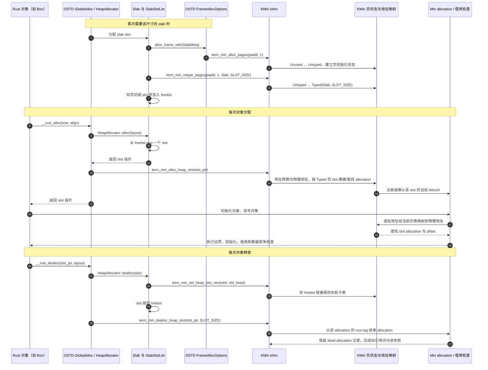

# Asterinas 与 KMiri 的内存分配交互

本文沿着一次内核堆分配和释放，说明 Asterinas 的 OSTD allocator 如何把页与 slab slot 的生命周期通知 KMiri，以及 KMiri 如何把这些地址映射为 Miri allocation。这里描述的是当前工作区中的实现；普通硬件构建不调用 KMiri shim，`#[cfg(miri)]` 下才启用这些交互。

## 两层分配

Asterinas 的内存分配分为两层：

1. **页层**：OSTD `FrameAllocOptions` 向全局 frame allocator 申请一个或多个物理页。物理页是 slab、页表等内核对象的存储后备。
2. **对象层**：OSTD 全局堆分配器根据 `Layout` 返回 slab 中的 slot，或对较大请求返回一段连续页。Rust 的 `Box`、`Vec` 等通过 `GlobalAlloc` 使用这一层。

KMiri 也对应维护两种状态：页层的 `PageState`（`Unused`、`Untyped`、`Typed`），以及 Miri 的 allocation（带有 `AllocId`、大小、对齐和借用状态）。一页可以容纳多个 slab slot；每个 slot 在 KMiri 中是独立 allocation，所以同一 slab 页仍在使用时，slot 也可以单独结束并在复用时开始新一代 allocation。

## 一个 slab 对象的完整路径

该 mermaid 图见在此[链接](https://mermaid.ai/d/4fcaaf30-0d16-4be5-8d91-52afb368c573)中缩放查看。

上图中的页通知发生在 slab 页创建时；slot 通知发生在每次对象分配和释放时。两者不能互相替代：只跟踪页状态，可以发现整页释放后的访问，却不知道 slab 页中单个对象何时被 allocator 回收。

## 各阶段在做什么

### 1. 申请物理页并记录页状态

`FrameAllocOptions::alloc_frame_with` 和 `alloc_segment_with` 先调用 Asterinas 的全局 frame allocator 得到物理地址。Miri 构建随后调用 `kern_miri_alloc_pages(paddr, count)`。KMiri 检查这些页原来是 `Unused`，把它们置为 `Untyped`，并建立初始化掩码。清零通过 `kern_miri_zero` 完成，让真实模拟内存中的字节与 Miri 初始化状态一致。

页的最终释放由 `Frame` / `UniqueFrame` 的 drop 路径调用 `kern_miri_dealloc_pages`。KMiri 将页变回 `Unused`，移除初始化掩码，并清除这一页上已登记的对象映射。页分配和释放关注的是整页所有权与状态。

主要入口：

* Asterinas：`ostd/src/mm/frame/allocator.rs`、`ostd/src/mm/frame/mod.rs`、`ostd/src/mm/frame/unique.rs`
* KMiri：`src/shims/foreign_items.rs` 中的 `kern_miri_alloc_pages` / `kern_miri_dealloc_pages` 分支；页状态操作在 `src/mirch/physical_mem.rs`

### 2. 把页改为 slab，并切成 slots

`Slab::new` 用 `FrameAllocOptions` 申请一页作为 slab，再调用 `kern_miri_retype_pages`，提供页类型 `Slab` 和 `SLOT_SIZE`。KMiri 把这页从 `Untyped` 改为 `Typed`，保存 slot 大小。此时 KMiri 有足够信息知道页内每个对象边界，但不会立即为整页的所有 slot 建立 Miri allocation。

OSTD 将页按 `SLOT_SIZE` 切开，空闲 slot 进入 `SlabSlotList`。普通硬件构建把 freelist 的 `next` 指针写在 slot 开头。在 KMiri 构建中，这个 freelist 链接放在 `PhysicalMemory.heap_slot_next` 影子表中：对象 slot 可以结束 Miri allocation，而 allocator 仍能管理空闲链表，不会通过已经结束的对象 allocation 读写链表字段。

### 3. 从 slab 取 slot 并建立当前对象 allocation

Rust allocator shim 进入 OSTD 的 `AllocDispatch::alloc`，再由 OSDK 提供的 `HeapAllocator` 从相应大小类别的 slab 中取 slot。slot 确认为 `SlabSlot` 后，KMiri 构建调用 `kern_miri_alloc_heap_slot`。

这个 shim 最终使用地址到 allocation 的解析逻辑。若该 slot 尚无当前活跃的 `AllocId`，`alloc_id_from_addr` 识别到它位于 `Typed` 页，就调用 `kernel_allocation_at`，在伪物理内存对应位置建立一个大小和对齐均为 `SLOT_SIZE` 的 Miri allocation，并记录物理地址到 `AllocId` 的映射。若分配映射已存在，则复用当前映射。`alloc_heap_slot` 因此也是分配器与 KMiri 同步 slot generation 的边界。

对象之后的普通 Rust 读写仍走 Miri 原有访存检查。对于 exposed/wildcard 地址，KMiri 将虚拟地址按当前页表翻译为物理地址，再从按物理地址排序的映射表找到所属 allocation 和 offset。具体的初始化、越界、借用和数据竞争规则由 Miri 执行。

### 4. 归还 slot 并结束对象 allocation

`GlobalAlloc::dealloc` 先把 slot 交还 OSDK heap allocator。slab freelist 使用影子表写入 `next`，因此不会复用对象的 Miri allocation 存放 allocator 元数据。成功归还之后，OSTD 调用 `kern_miri_dealloc_heap_slot`。

KMiri 找到 slot 当前的 `AllocId`，并调用 Miri `deallocate_ptr` 结束该 allocation。传给 deallocation 的 provenance 使用该 allocation 的 root tag，避免沿用 `Box` 或其他 Rust 对象派生出来的 tag 作为 allocator 根指针。Miri 随后把 allocation 记录为已释放；仍保存旧对象引用的代码在访问时会遇到 dangling / use-after-free 或借用检查错误。slab 所在页仍是 `Typed`，slot 再次分配时可创建新的 allocation generation。

### 5. 大对象走页段路径

超过 OSDK slab size class 范围的分配由 `HeapSlot::alloc_large` 直接申请连续 `Segment`，释放时 drop 该 segment。它不走 slab freelist，也不调用 `kern_miri_alloc_heap_slot` / `kern_miri_dealloc_heap_slot`；主要由页级通知跟踪底层 segment 的页范围。本文图中的 per-slot 生命周期 shim 特指 slab slot 路径。

## 地址与对象的对应关系

KMiri 需要把三个地址概念对齐：

* OSTD allocator 返回的是内核虚拟地址。
* 页状态和 allocation 地址映射使用物理地址；有页表时，KMiri 通过模拟的当前页表完成虚拟地址到物理地址翻译。
* Miri allocation 的实际字节由 `create_allocation_at` 指向 `PhysicalMemory` 连续缓冲区中对应物理地址的偏移，因此不会产生与内核模拟内存脱节的第二份对象数据。

按需创建 allocation 时，KMiri 也会从对应页的初始化掩码拷贝初始化信息。这样即使对象 allocation 是访问时才建立的，Miri 看到的初始化状态仍能继承底层页的状态。

## 关键接口对照

| 接口 | 调用方时机 | KMiri 中的效果 |
| --- | --- | --- |
| `kern_miri_alloc_pages` | OSTD 分配 frame / segment | 检查 `Unused`，转为 `Untyped`，建立初始化掩码 |
| `kern_miri_retype_pages` | 页改作 slab、页表等用途 | `Untyped` 转为 `Typed`，记录用途和 slot 大小 |
| `kern_miri_alloc_heap_slot` | slab slot 从 freelist 取出、返回给 Rust allocator 前 | 按需建立或确认当前 slot allocation |
| `kern_miri_dealloc_heap_slot` | slab slot 归还 allocator 后 | 结束当前 slot allocation，检查借用有效性 |
| `kern_miri_set_heap_slot_next` / `kern_miri_get_heap_slot_next` | Miri 模式下 freelist push / pop | 在影子表中保存或取出 freelist 链接 |
| `kern_miri_dealloc_pages` | frame / segment 生命周期结束 | 清除页状态、初始化掩码和页内对象映射 |

这些接口在 `ostd/src/arch/miri/mod.rs` 声明，由 `osdk/src/base_crate/miri.ld.template` 导出符号；KMiri 在 `src/shims/foreign_items.rs` 中实现 foreign-item shim。非 Miri 的硬件构建不执行这些解释器调用，仍按原有 allocator 数据结构工作。

## 为什么 slot 通知不能省略

若只有 `kern_miri_alloc_pages` 和 `kern_miri_retype_pages`，slab 页会一直保持 `Typed`，KMiri 还会在第一次访存时为 slot 懒创建 allocation。但是 OSTD 释放一个 `Box` 只把 slot 放回 slab，页仍在使用；没有 per-slot deallocation 通知时，KMiri 看不到对象生命周期结束。此后通过悬空引用读取时，旧 allocation 仍显得有效，可能只读回已经复用或尚未覆盖的旧字节，无法得到预期 UAF 报告。

因此正确建模要同时保留页的生命周期和对象 slot 的生命周期：页状态描述底层页能否使用、被怎样切分；slot allocation 描述某一个 Rust 对象当前是否仍活着。freelist 影子表则隔离 allocator 元数据，保证结束对象 allocation 不会破坏内核分配器自身的链表操作。
