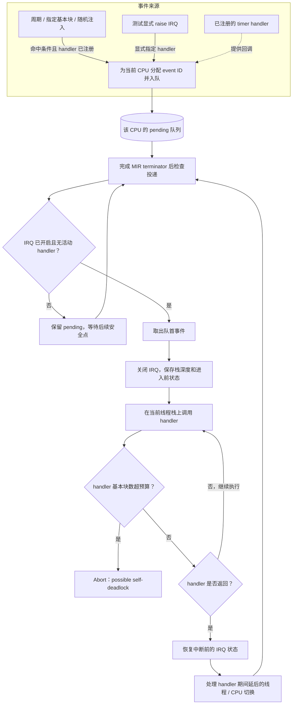

# IRQ timer 和 deadlock 检测

本文描述当前 KMiri 和 Asterinas 工作树中的实现，并从配置测试到自锁测试逐步说明如何观察中断屏蔽、pending 投递和中断上下文不进展。实现目标来自 Asterinas Issue [#4147](https://github.com/asterinas/asterinas/issues/4147)：任务持有 `LOAD_AVG` 读锁时，同 CPU 定时器中断进入更新路径，handler 获取写锁时等待被它自己暂停的读者。

Issue 已由上游提交 [c052edc](https://github.com/asterinas/asterinas/commit/c052edcf9543445664a85a40286bd8eeb5bb2d12) 修复，`LOAD_AVG` 使用 `RwLock<_, LocalIrqDisabled>`。当前改动不复现完整的 `LOAD_AVG`/kernel 调用链：KMiri 用核心测试验证通用 IRQ 调度与 watchdog，Asterinas 则接入 OSTD IRQ/timer 路径，并用精简内核测例验证同 CPU 锁自锁关系。

## 中断事件的产生与投递

图中展示了 IRQ 的两个阶段：事件源只负责把 handler 放入对应 CPU 的 pending 队列；解释器在完成 MIR terminator 后的安全点检查是否可以投递。关闭 IRQ 或已有活动 handler 时，事件留在队列中。handler 在当前线程栈上运行，被打断的任务暂停；超过基本块预算则由 watchdog 报告可能的自锁。

<details>

<summary>中断模拟过程</summary>



</details>

同 CPU 自锁发生在 `Call` 阶段：handler 等待被暂停在 `raise_irq` 后面的任务释放锁，而该任务要等 handler 返回后才能继续。watchdog 根据 handler 已完成的基本块数打断这类无进展执行。

### 术语

| 术语 | 含义 |
| --- | --- |
| **IRQ** | 可屏蔽中断（interrupt request）。本文中的 IRQ 主要指 KMiri 模拟的 timer 中断，用于在内核执行期间调用已注册的 handler。 |
| **事件来源** | 产生待处理 IRQ 的方式。当前包括按基本块周期注入、指定基本块注入、随机注入，以及测试通过 `raise_irq` 显式排入 handler。 |
| **timer handler** | 由 OSTD 或测试注册、在模拟 timer IRQ 到达时调用的 Rust 回调。周期或随机注入是事件产生机制，不代表真实时间流逝。 |
| **pending 队列** | 每个 CPU 各自的待处理事件队列。IRQ 事件到达时会分配 `event ID` 并排入当前 CPU 的队列；如果 IRQ 关闭或暂时不能投递，事件会留在队列中等待。 |
| **event ID** | 每个排队事件的递增编号，用于把入队、投递、返回和 watchdog 诊断中的记录对应起来。它标识一次 IRQ 事件，不是硬件中断向量号。 |
| **安全点（safe point）** | KMiri 完成一条 MIR terminator、基本块即将切换时检查 pending 队列的位置。只有在这里才尝试调用 handler，避免在普通 MIR 操作执行到一半时改动解释器调用栈。它是 KMiri 当前模拟选择的检查粒度，不表示真实 CPU 只会在基本块边界响应中断。 |
| **投递（delivery）** | 安全点确认 IRQ 已开启、当前没有活动 handler 且有 pending 事件后，取出队首事件，并在当前 KMiri 线程的调用栈上调用 handler。被中断的任务暂停在原位置，handler 返回后再继续。 |
| **IRQ 屏蔽 / 恢复** | `irq_disable` 阻止安全点投递可屏蔽 IRQ，但不会清空 pending 队列；`irq_enable` 允许之后的安全点投递积压事件。嵌套 guard 应恢复进入时的状态，内层 guard 不能提前打开外层已关闭的 IRQ。 |
| **活动 handler（active）** | 当前正在执行的 IRQ handler。第一版同一 CPU 同时只运行一个活动 handler；handler 期间新到的 timer 事件不会递归打断它，而是继续排队。 |
| **中断上下文** | handler 执行期间的解释器状态。KMiri 保存被中断时的栈深度与 IRQ 状态，在 handler 返回后据此识别返回边界并恢复状态。这里没有真实硬件 trap frame 或寄存器现场。 |
| **watchdog** | handler 基本块预算检查器。活动 handler 执行的基本块数超过 `handler_budget_basic_blocks` 后，KMiri 以 `IRQ watchdog: possible self-deadlock` 中止执行，并附带事件、CPU、计数和调用栈信息。它是进度异常启发式，不是死锁证明；预算太低也可能拦下合法但较慢的 handler。 |
| **同 CPU 自锁** | 被中断任务持有某个锁，IRQ handler 在同一 CPU 上等待该锁。由于 handler 执行时原任务暂停，原任务不能运行到释放锁的位置，形成无法前进的等待；这正是 watchdog 测例模拟的关系。 |
| **基本块计数** | KMiri evaluator 已完成的 MIR 基本块计数，用于周期、定点和随机注入，也用于统计 handler 工作量。它不是硬件 cycle、时间或机器指令数。 |

## 1. 从配置开始：启用可控的 IRQ 模型

所有 IRQ 选项都放在 `KMiriConfigToml` 的 `[irq]` 子表中，仍使用已有的 `-Zkmiri-toml=<path>` 传入。未写 `[irq]` 时 IRQ 模拟默认关闭，因此现有 KMiri 程序不受影响。

```toml
page_table = false
total_mem_size = 0x8000000

[irq]
enabled = true
tick_interval_basic_blocks = 0
inject_at_basic_blocks = []
random_injection_rate = 0.0
random_seed = 0
handler_budget_basic_blocks = 10000
trace = true
```

字段含义：

| 字段 | 当前行为 |
| --- | --- |
| `enabled` | 启用 IRQ shims 和事件投递；默认 `false`。 |
| `tick_interval_basic_blocks` | 非零时，每到全局 `basic_block_count` 的整数倍，排入一次 timer IRQ。 |
| `inject_at_basic_blocks` | 在指定的全局基本块计数上排入 timer IRQ。 |
| `random_injection_rate`、`random_seed` | 用独立的 seeded RNG 按基本块尝试随机排入 timer IRQ。概率必须在 `0.0..=1.0` 内。 |
| `handler_budget_basic_blocks` | 单个活动 handler 执行的基本块数超过此值时触发 watchdog；启用 IRQ 时不能设为零。 |
| `trace` | 将注册、开关、排队、投递和返回事件写入 stderr。 |

解析、默认值和字段 getter 位于 `kmiri/src/mirch/config_toml.rs`。`IrqConfigToml` 作为 `KMiriConfigToml` 的字段解析；`KMiriConfigToml::new` 检查随机概率和 handler 预算。`MiriMachine::new` 从已有 `kmiri_toml` 读取配置，并用 `random_seed` 初始化单独的 IRQ 随机数发生器。

对应单元测试 `irq_defaults_and_values` 检查默认关闭、默认预算及显式字段解析。运行：

```sh
# 从 KMiri 仓库根目录
./miri test irq_defaults_and_values
```

## 2. 最小运行状态与 IRQ shim

`kmiri/src/machine.rs` 中的 `MiriMachine` 持有 IRQ 状态。当前代码为 `CPU_NUM` 个 CPU 各建一份 `CpuIrqState`；测试程序从 CPU 0 开始运行。每份状态包含：

- `enabled`：本 CPU 是否允许投递可屏蔽 IRQ，初始为 `true`；
- `pending`：已排队的 handler 和单调递增的事件 ID；
- `active`：当前 handler 的事件 ID、被中断时的栈深度、进入前的 IRQ 状态和已执行基本块数。

timer handler 单独保存在 machine 中，注册后供虚拟 timer 事件使用。当前版本没有单独的 `irq_depth`、`virtual_timer` 或硬件向量状态：一次只运行一个活动 handler，handler 期间新到期的 timer 不会递归进入。

`kmiri/src/shims/foreign_items.rs` 实现以下符号：

- `kern_miri_irq_is_enabled` 查询当前 CPU 状态；
- `kern_miri_irq_disable` 和 `kern_miri_irq_enable` 修改当前 CPU 状态；
- `kern_miri_register_timer_irq` 注册一个无参数 Rust handler；
- `kern_miri_test_raise_irq` 为核心测试显式排入 handler。

IRQ 模拟未启用时调用这些符号会以清晰的 abort 消息终止。KMiri 测试 helper `kmiri/dev/test_utils/irq.rs` 用 `IrqGuard` 保存并恢复原状态：嵌套 guard 在进入时若发现 IRQ 已关闭，析构时不会误开 IRQ。它还封装了 timer 注册和显式排队接口。Asterinas 的 `ostd/src/arch/miri/irq.rs` 现在将 IRQ 查询、屏蔽和恢复接到这些 shims；Miri timer 初始化也注册 OSTD timer callback 入口。Asterinas 内核测例通过 OSTD API 走真实 guard 和 timer callback 路径。

## 3. 第一条运行测例：timer 自动注入

`tests/pass/kmiri/irq-timer-injection.rs` 是最简单的端到端验证。它先注册 handler，再等待一个原子计数变化：

```rust
irq::register_timer_irq(timer_handler);
while TIMER_RUNS.load(Ordering::SeqCst) == 0 {
    std::hint::spin_loop();
}
assert_eq!(TIMER_RUNS.load(Ordering::SeqCst), 1);
```

该测试使用 `dev/test_utils/irq-timer.toml`：`tick_interval_basic_blocks = 64`，IRQ 已启用，watchdog 预算为 10000。`trace` 关闭，以免测试主函数结束后的运行时清理过程继续产生周期 timer 日志；handler 是否确实被自动调用由 `TIMER_RUNS` 断言验证。

注入与投递分成两个时点：

1. `MiriMachine::before_terminator` 先增加现有的全局 `basic_block_count`，然后调用 `maybe_queue_timer_irq`。达到配置的周期、固定计数点或随机命中时，若已有注册 handler，就为当前 CPU 入队并分配 event ID。
2. `step_current_thread` 比较执行前后的基本块计数。只有完成了 terminator、计数发生变化时，才检查 pending 队列并尝试投递。因此 timer 事件不会在 `enable` shim 或普通 MIR statement 执行到一半时改写解释器栈。

这个测试验证周期 timer 从配置、handler 注册、事件产生到 handler 执行的路径。它不验证真实时间或硬件时钟；周期以解释器的全局基本块数为单位。固定基本块注入和随机注入由同一队列/投递路径处理，但目前这两种模式还没有专门的集成测例。

## 4. 第二条运行测例：关闭 IRQ 时排队，恢复后再投递

`tests/pass/kmiri/irq-pending-delivery.rs` 逐步验证屏蔽语义和 guard 恢复顺序。测试使用 `AtomicUsize` 实现一个极简读写锁状态：低位表示 reader 数量，最高位 `WRITER` 表示 writer 持锁。reader 已持锁时，writer 只有在原子状态为零时才能 CAS 成功。

主要执行顺序如下：

1. 创建外层和内层 `IrqGuard`。外层记录 `was_enabled = true` 并关 IRQ；内层记录 `false`，因此它析构时不会重新打开 IRQ。
2. 取得 reader 锁后调用 `raise_irq`。`kern_miri_test_raise_irq` 只将 handler 放到当前 CPU 的 pending 队列。安全点看到 IRQ 关闭，因此不调用 handler；随后 `HANDLER_RUNS == 0` 断言确认这一点。
3. 释放 reader，再释放内层 guard。此时外层 guard 仍关着 IRQ，第二个 `HANDLER_RUNS == 0` 断言确认 pending 事件仍未投递。
4. 释放外层 guard。它恢复进入前的 enabled 状态。下一次完成 MIR terminator 的安全点取出 pending handler；handler 此时能够取得 writer 锁、增加运行计数并释放锁。
5. 测试断言 handler 恰好运行一次，且锁状态恢复为零。

测试 TOML 是 `dev/test_utils/irq.toml`，显式 raise 的事件 ID、排队时 IF 状态、pending 数、投递块计数和返回状态可由 `trace = true` 输出观察。对应的 `.stderr` 快照保存一条通过轨迹。这里由锁状态和计数断言验证正确性，trace 用来解释发生顺序。

## 5. 第三条运行测例：IRQ handler 等待被打断的 reader

`tests/fail/kmiri/irq-self-deadlock.rs` 构造与 Issue #4147 同构的进度问题：main 持有静态锁的 reader 状态，IRQ handler 在同一解释器线程和 CPU 上尝试拿 writer 锁。handler 中没有其他执行者能够释放 main 的 reader，所以 CAS 一直失败。

简化锁的关键条件是：

```rust
LOCK.compare_exchange(0, WRITER, Ordering::Acquire, Ordering::Relaxed)
```

main 进入 handler 时 reader 计数仍为 1。`irq::raise_irq(timer_irq_handler)` 入队后，IRQ 已启用，故 handler 在安全点压入当前调用栈；它反复执行 `write_lock`，而底层 main 栈帧暂停在 `raise_irq` 调用返回点。这个用例不依赖随机调度，也不需要完整 OSTD `RwLock`。

watchdog 在 `step_current_thread` 观察到活动 IRQ 后，按完成的 MIR 基本块累计 handler 工作量。当 `handler_blocks > handler_budget_basic_blocks` 时，以 `TerminationInfo::Abort` 报告 `IRQ watchdog: possible self-deadlock`。诊断包括 event ID、CPU、KMiri 线程、全局计数、handler 块数与预算、pending 数、IF 状态，以及按活动 IRQ 保存的栈深度拆分出的 handler 栈和被中断栈。默认显示每段栈顶附近最多八个函数名。

本测例以 `//~ ERROR` 检查 watchdog 标题，并用 `tests/fail/kmiri/irq-self-deadlock.stderr` 固定诊断和普通 backtrace。watchdog 是进度异常的启发式判定：预算过低时，合法但较重的 handler 也可能触发它；它报告“possible”，不把预算超限等同于数学上的死锁证明。

## 6. 安全点投递、handler 返回与调度约束

上述三条测例共用的 evaluator 路径位于 `kmiri/src/concurrency/scheduler.rs`：

1. `step_current_thread` 在一次 `step` 前后读取 `basic_block_count`。只有计数变化时才把该次执行视为完成了 terminator，可在之后的 MIR 块边界投递 IRQ。
2. 投递前要求 IRQ 已启用、当前 CPU 没有活动 handler、pending 非空，且栈顶 frame 仍有可恢复的 MIR block。
3. KMiri 保存当前栈深度和事件信息，先将 IRQ 设为关闭，再用解释器已有的 `call_function` 把 handler 推入当前线程栈。`ReturnContinuation::Goto` 指向被打断 frame 的后继 block。
4. 活动 handler 期间，`schedule` 提前继续当前线程，不处理线程切换和 CPU 切换；普通 yield 标记被清除，已排队的显式线程/CPU 切换请求留到 handler 结束后再处理。handler 正常返回到保存的栈深度后，machine 恢复进入中断前的 IRQ enabled 状态。

因此模拟的是“同一 CPU 上同步执行回调，同时暂停被打断任务”的关键关系。第一版不模拟真实硬件 trap frame、寄存器保存、硬件中断控制器或中断嵌套；注入粒度也只有 MIR terminator/基本块边界，并不等同于逐条机器指令的中断时机。

## 7. 运行与观察结果

从 KMiri 仓库根目录运行三条 IRQ 测例：

```sh
./miri test kmiri/irq
```

命令应报告两个 pass 用例和一个带预期错误的 fail 用例均通过。`--bless` 仅在有意调整 trace/诊断快照时使用：

```sh
./miri test --bless kmiri/irq
```

Asterinas OSTD 的 IRQ 状态和 pending 投递由 `../tests/irq-simulation` 验证，从 KMiri 仓库根目录运行：

```sh
make asterinas ASTERINAS_TEST=irq-simulation
```

该测例在 OSTD 初始化后先断言 IRQ 已开启，再注册 timer callback。在嵌套 `ostd::irq::disable_local()` guard 内，它分别断言外层关闭、内层仍关闭、IRQ 排队后仍关闭，且 callback 尚未执行。释放内层 guard 后，IRQ 仍关闭且 callback 仍未执行；释放外层 guard 后，IRQ 恢复开启，pending timer callback 恰好执行一次。callback 记录运行时 IRQ 状态和中断 level，测例随后断言 IRQ 在 callback 中关闭，且 level 是 `InterruptLevel::L1(PrivilegeLevel::Kernel)`。

IRQ watchdog 在 OSTD 锁路径中的触发由 `../tests/irq-deadlock` 验证：

```sh
make asterinas ASTERINAS_TEST=irq-deadlock
```

测例使用 `RwLock<(), WriteIrqDisabled>`。任务持有读锁时确认 IRQ 仍开启，然后显式排入 OSTD timer IRQ；timer callback 在同 CPU 的 L1 中请求同一把锁的写锁。写者只能等待仍被中断任务释放的 reader，因而持续自旋。测例预期由 KMiri watchdog abort，而 Makefile 捕获进程输出并要求其中包含 `IRQ watchdog: possible self-deadlock`，所以诊断匹配时 Make 目标成功。`irq-deadlock` 也已列入 `ASTERINAS_TESTS`，完整 Asterinas 测试目标会按此预期失败规则处理它。

当前可观测证据分为两类：

- **程序断言**：KMiri 核心测试检查 timer handler 调用、pending 投递和自锁诊断；Asterinas `irq-simulation` 检查 OSTD 暴露的本地 IRQ 状态、嵌套 guard 恢复、callback 屏蔽状态及中断 level；Asterinas `irq-deadlock` 检查读锁期间 IRQ 开启，并由 watchdog 诊断 handler 自锁。
- **解释器输出**：KMiri `trace` 记录 IRQ 状态变化、事件排队/投递/返回、CPU、线程、全局基本块计数和 pending 数；watchdog 诊断包含预算及 handler/被中断调用栈。Asterinas 测例用 `miri_println!` 标记 pending 投递完成和死锁触发点，死锁时 KMiri 输出 watchdog 诊断。

相同测试源和 TOML 配置可以重放同一条确定性轨迹。随机注入需要同时固定 `random_seed`，但不应用随机“没复现”作为安全结论。

## 8. 当前范围与后续集成

当前 KMiri shims 已接入 Asterinas Miri arch：`ostd/src/arch/miri/irq.rs` 负责本地 IRQ 状态操作，`ostd/src/arch/miri/timer/mod.rs` 注册并实现 timer 入口，入口在 L1 kernel interrupt level 下调用现有 `call_timer_callback_functions`。`../tests/irq-simulation` 验证了嵌套 IRQ guard 的屏蔽与恢复，以及 OSTD timer callback 的延迟投递。共享 `tests/asterinas.toml` 启用 IRQ 模拟但关闭周期注入，避免其它 Asterinas Miri 测例在未显式触发时收到 timer IRQ。

当前集成测例仍不触发 `LOAD_AVG`、`update_loadavg()` 或 `/proc/loadavg`，也没有修改 `kernel/core/src/sched/stats/loadavg.rs`。它证明了 Asterinas IRQ 原语能够驱动 KMiri 模型，并通过真实 OSTD `RwLock`、timer callback 和 IRQ guard 重现“被中断任务持有 reader、IRQ handler 等待 writer”的进度问题；#4147 的完整调用链仍需等待 KMiri 能解释相关 OSTD/kernel 路径后验证。

为减少 Miri 测试输出中的地址噪声，Asterinas `ostd/src/mm/kspace/kvirt_area.rs` 不再逐帧打印 `paddr`、`vaddr` 和虚拟地址游标，`ostd/src/mm/kspace/mod.rs` 也移除了 Miri 专用的页表映射范围和初始化阶段明细。常规高层日志仍保留。

下一阶段可以在具备所需解释能力后，用修复前后的 `LOAD_AVG` 锁类型做同事件点对照，并评估基本块安全点对真实短临界区的覆盖；必要时再增加 statement 级或锁事件定向注入。
