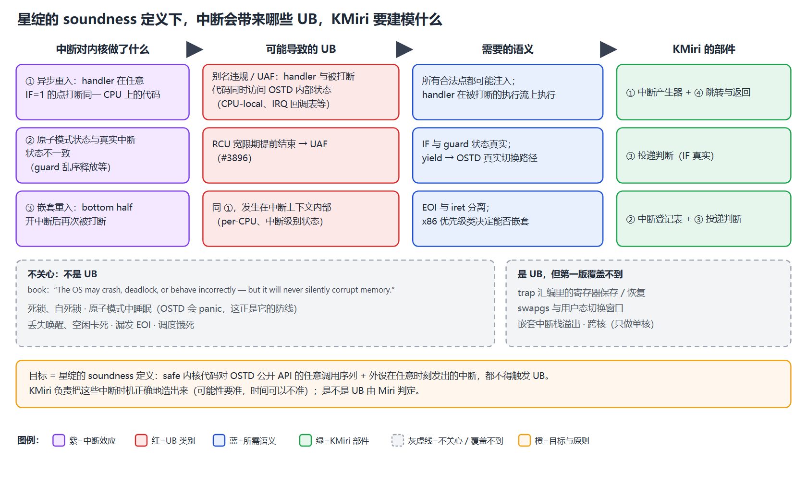
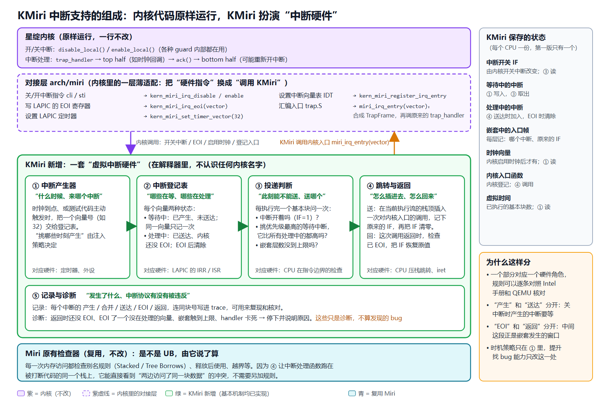
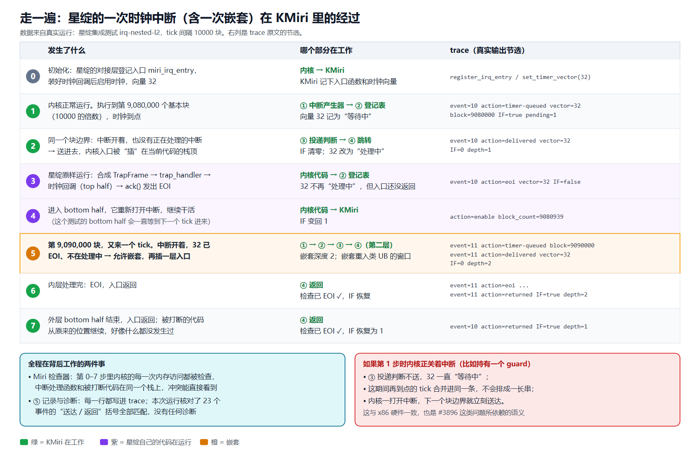
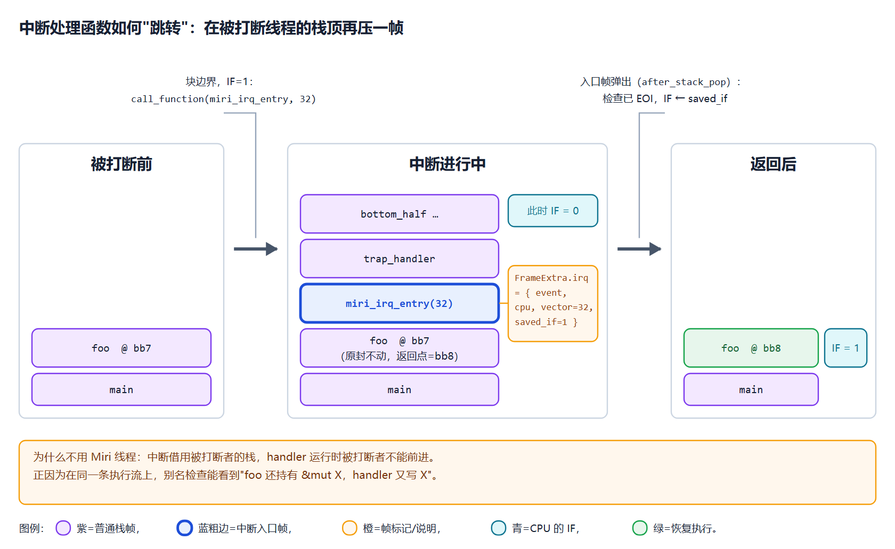
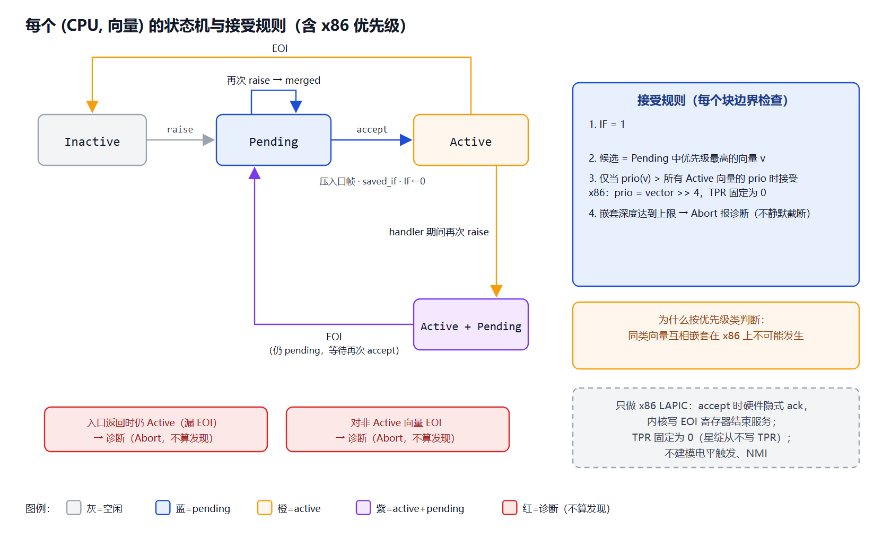
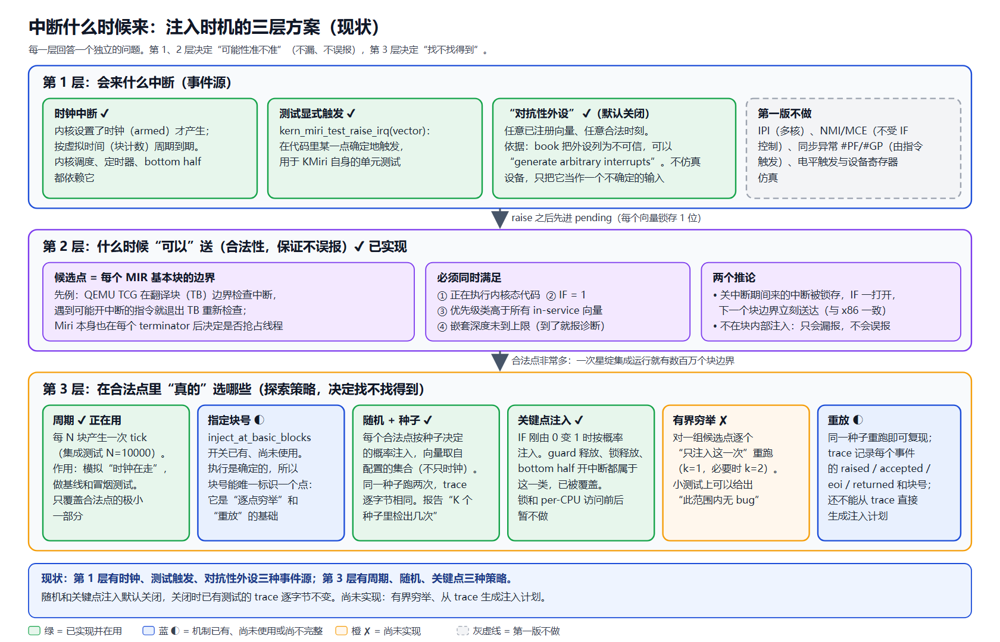

# 中断机制的整体设计与进展

本文从整体上说明 KMiri 打算怎样模拟中断：要解决什么问题、整体结构如何划分、一次中断在 KMiri 里怎样发生、中断在什么时候注入，以及目前做到了哪一步。本文只讲设计思路和结论，不涉及具体代码和配置项。

- 前面的 [IRQ timer 和 deadlock 检测](./v1.md) 和 [重现 RCU UAF](./v1_repro_3896.md) 描述的是已经合入上游的第一版实现。本文描述在它之上继续推进的整体设计。
- 文中标“已实现”的部分，表示已在开发分支实现并有测试，但还没有全部合入上游，具体状态见 [目前进展](#目前进展)。
- 设计讨论和 PR 进度在 [Discussion #322](https://github.com/orgs/KMiri-rs/discussions/322) 中跟踪。本文内容截至 2026-11-15。

## 为什么 KMiri 需要模拟中断

Miri 是顺序解释器：程序从头执行到尾，中途不会被打断。真实内核则不同，只要中断是开着的，CPU 就可能在任意一条指令之后跳去执行中断处理函数，处理完再回到原来的位置继续执行。有些 UB 只有在“执行到一半被中断打断”时才会出现，例如中断处理函数和被打断的代码同时持有同一块数据的引用。这类 UB 在原版 Miri 里完全看不到。

KMiri 的做法是：在解释执行内核时把中断“造”出来，再交给 Miri 原有的检查器判断有没有 UB。KMiri 负责“中断会在哪里、以什么方式发生”，是不是 UB 仍由 Miri 判定。

## 目标与范围

目标直接取自星绽对 soundness 的定义：safe Rust 编写的内核代码，无论以什么顺序调用 OSTD 的 safe 公开 API，再加上用户程序和外设的任意行为，都不能触发 UB。内核可以崩溃、死锁或行为错误，但不能悄悄破坏内存。

由此可以得出三点：

- **只有 UB 算发现。** 死锁、卡死、漏发 EOI 等问题在定义中是允许的，KMiri 只把它们作为诊断报告出来，不算 bug。
- **中断时机是不可信的输入。** 外设可以在任何时候发出中断，所以中断在任何合法时刻到来，OSTD 都必须保持 sound。
- **验证时不改 OSTD。** 用来触发问题的代码都是只调用 OSTD 公开 API 的 safe Rust。如果为了报出 UB 而修改了 OSTD，报出来的问题就不能算 OSTD 的问题。

在单核、只打断内核态的前提下，中断能带来的 UB 可以归为三类：

| 类别 | 中断做了什么 | 可能的 UB | 实例 |
| --- | --- | --- | --- |
| 异步重入 | 中断处理函数在中断开着的任意位置打断同一 CPU 上的代码 | 两边通过引用访问同一数据，造成别名违规或 UAF | 暂无，属于前瞻性目标 |
| 状态不一致 | “处于原子模式”的记录与真实的中断开关状态对不上，例如 guard 没有按顺序释放 | RCU 宽限期提前结束，造成 UAF | [asterinas#3896](https://github.com/asterinas/asterinas/issues/3896) |
| 嵌套重入 | bottom half 重新打开中断后再次被打断 | 与异步重入相同，只是发生在中断上下文内部 | [asterinas#1648](https://github.com/asterinas/asterinas/issues/1648) |

第一版只做 **x86、单核、只打断内核态**，目标内核是星绽。多核与 IPI、打断用户态、NMI、同步异常（如缺页）、设备寄存器仿真和精确时序都暂不考虑。

## 设计原则

| 原则 | 含义 |
| --- | --- |
| 可能性要准，时间可以不准 | 硬件上可能被打断的地方都要能打断，否则会漏报；硬件上不可能被打断的地方绝不打断，否则会误报。真实的时钟周期不重要，bug 只取决于某种执行顺序能不能出现。 |
| 只建模内核看得见的状态 | 不仿真中断控制器（LAPIC）的寄存器。内核通过一组固定的接口与 KMiri 交互，KMiri 只维护会影响内核执行路径的状态。 |
| UB 由 Miri 判定 | KMiri 自己发现的协议问题（漏发 EOI、嵌套过深等）只作诊断，不算 UB。 |
| 中断处理函数运行在被打断的执行流上 | 真实硬件上，中断借用被打断代码的栈运行，被打断的代码在此期间停住不动。KMiri 也这样做，Miri 的别名检查才能看到两边的冲突。 |
| 边界要显式 | 遇到不支持的情况时报诊断并停止，不做静默的近似，以免把漏报误当成“没有 bug”。 |

## 整体结构：KMiri 扮演“中断硬件”

在真实的 x86 机器上，一次中断由几方共同完成：定时器或外设产生中断，中断控制器记录哪些中断在等待、哪些正在处理，CPU 在指令边界判断能否接受并跳转，最后由内核软件处理。Miri 里没有前三者，所以 KMiri 在解释器中补上这些角色，内核的中断处理代码原样运行。

整体分为四层：

1. **星绽内核，原样运行。** 开关中断的 guard、`trap_handler`、top half、`ack()`、bottom half 都是原来的代码。
2. **对接层 `arch/miri`。** 这一层位于内核内部，把“执行硬件指令”换成“调用 KMiri”。例如关中断改为调用 KMiri 的接口；反过来，KMiri 要投递中断时调用这一层的统一入口，入口再调用原来的 `trap_handler`，起到汇编入口 `trap.S` 的作用。
3. **KMiri 新增的“虚拟中断硬件”。** 分为中断产生器、登记表、投递判断、跳转与返回、记录与诊断五个部分。这一层不认识任何内核的名字，换一个内核只需要重写对接层。
4. **Miri 原有的检查器。** 直接复用，不做修改。

内核与 KMiri 之间的接口很小，每个接口对应一个真实的硬件操作：

| 接口 | 对应的硬件操作 |
| --- | --- |
| 登记统一中断入口（参数是向量号） | 设置中断向量表（IDT） |
| 开中断 / 关中断 / 查询中断是否开启 | `sti` / `cli` / 读 RFLAGS.IF |
| 结束某个向量的服务（EOI） | 写 LAPIC 的 EOI 寄存器 |
| 设置时钟中断的向量号 | 配置 LAPIC 定时器 |
| 在测试代码中主动触发某个向量 | 无，仅供测试使用 |

中断的身份统一用 **向量号** 表示，与真实硬件一致。之所以先把接口定下来，是因为它是每个内核都要配合修改的部分；接口稳定以后，KMiri 内部的规则再怎么调整，也不必再改内核。

## 一次中断在 KMiri 中怎样发生

下图按时间顺序走一遍星绽的一次时钟中断，其中包含一次嵌套。数据来自一次真实运行的记录。

概括起来：

1. 时钟到点，向量 32 被登记为“等待中”。
2. 在下一个基本块边界，如果中断开着、也没有更高优先级的中断正在处理，就投递这个中断：在当前执行流的栈顶压入内核的中断入口，同时关中断。
3. 星绽自己的中断处理代码开始运行，在 top half 末尾发出 EOI，然后进入 bottom half。
4. bottom half 重新打开中断。此时如果又有时钟中断到来，就会嵌套进入第二层。嵌套重入类 UB 正是发生在这个窗口里。
5. 内层返回，外层再返回，中断开关恢复成被打断前的状态，被打断的代码从原处继续执行。

### 中断处理函数借用被打断者的栈

KMiri 没有为中断处理函数单独开一个 Miri 线程，而是把它压在被打断代码的栈顶运行。

这样做有两个原因。第一，这与真实硬件一致：中断处理期间，被打断的代码不可能继续向前执行。第二，两边处在同一条执行流上，如果被打断的代码还持有某个可变引用，而中断处理函数又写了同一块数据，Miri 的 Stacked Borrows / Tree Borrows 检查能直接报出这个冲突。

这个选择也有代价：既然两边处在同一个 Miri 线程上，Miri 的数据竞争检测就不会把它们当作两个线程。只经过裸指针的非原子冲突不会被报出；经过引用的冲突仍然由别名模型报出。

### 等待、处理与 EOI 的规则

KMiri 为每个向量记录它当前处于“空闲”“等待中”“处理中”中的哪种状态，规则参照 x86 LAPIC：

- **产生和投递分开。** 关中断期间产生的中断先登记为等待中，同一个向量只记一次，重复的合并为一次。中断一打开，下一个块边界就投递。
- **EOI 和返回分开。** 星绽在 top half 末尾就发出 EOI，之后才运行 bottom half，这一段正是允许嵌套的窗口。如果中断入口返回时还没有 EOI，KMiri 报诊断。
- **按 x86 优先级决定能否嵌套。** 每次从等待中的向量里挑优先级最高的一个，只有它的优先级类严格高于所有正在处理的向量时才接受。同一优先级类的中断互相嵌套在硬件上不可能发生，放进来就会产生误报。
- **嵌套深度有上限。** 达到上限时报诊断并停止，而不是悄悄丢弃中断。

## 中断在什么时候注入

“每隔 N 步打断一次”其实混合了三个不同的问题。KMiri 把它们拆成三层分别处理：

- **第 1 层：会来什么中断。** 包括时钟中断、测试代码主动触发的中断，以及“对抗性外设”。对抗性外设不仿真任何设备，只是在任意合法时刻对指定的向量注入中断，对应“外设行为不可信”的假设。
- **第 2 层：什么时候可以投递。** 候选点是每个 MIR 基本块的边界，投递时还必须满足中断开启、优先级足够高、嵌套没有超限。块边界是真实指令边界的一个子集，所以这种做法只可能漏报，不会误报。
- **第 3 层：在合法的候选点里选哪些。** 周期注入用来模拟“时钟在走”，让内核正常运转；随机注入配合固定的种子，结果可以重放；关键点注入在中断刚从关闭变为开启时按概率注入，guard 释放、锁释放、bottom half 重新开中断都属于这一类。

随机注入和关键点注入默认关闭。打开以后，评估方式也要相应改变：不再看单次运行的结果，而是统计“K 个种子里检出了几次”。

## 目前进展

下图按依赖顺序列出各阶段的状态。前一阶段是后一阶段的基础。

蓝色表示已合入上游，绿色表示已在开发分支实现并有测试、正在分批提交，灰色表示尚未开始。

| 阶段 | 目标 | 状态 |
| --- | --- | --- |
| 第一版 | 基本的中断注入、开关中断与 pending 投递、handler 自锁的 watchdog；用 slab 槽位模型复现 #3896 | 已合入上游，见 [v1](./v1.md) 和 [v1：重现 RCU UAF](./v1_repro_3896.md) |
| 中断 + 别名 | 说明加入中断后才出现的别名 UB 能被检出，正确代码不会误报 | 已实现，待提交 |
| 原生 trap 路径 | 中断经过星绽完整的 `trap_handler`、top half、bottom half，不再直接调用时钟回调；接口改为“统一入口 + 向量号” | 已实现，待提交 |
| 中断控制器状态 | 按 x86 区分等待、处理、EOI 和返回 | 已实现，待提交 |
| 嵌套与优先级 | 支持星绽真实的两层嵌套，不放进硬件上不可能的嵌套 | 已实现，待提交 |
| 注入策略 | 对抗性外设、关键点注入，默认关闭 | 已实现，待提交 |

目前已经得到的验证结果：

- **中断 + 别名：** 中断处理函数与被打断的代码通过引用访问同一数据时，Miri 报出 Stacked Borrows / Tree Borrows 错误；关中断保护的版本不报错；关闭中断注入后，同一个用例也不再报错。
- **星绽真实的嵌套：** bottom half 重新开中断后再次被时钟打断，KMiri 正确地进入了第二层，投递和返回的顺序与预期一致。
- **嵌套重入（#1648）：** 在单独的分支上用一行改动重新引入这个缺陷，KMiri 能报出嵌套超限；未修改的星绽上嵌套不超过两层，正常结束。这个变体只用来评估检出能力。
- **注入策略不误报：** 在未修改的星绽上打开随机注入和关键点注入，10 个种子共注入 800 多次，没有误报；在上述缺陷变体上，10 个种子全部失败，大多数由 KMiri 直接报出。

## 尚待解决的问题

- **bottom half 的其他执行时机。** 星绽除了在中断返回前运行 bottom half，还会在任务上下文中释放相应 guard 时，以及在专门的 softirq 线程里运行它。这两条路径目前还没有测试覆盖。
- **关键点的边界。** 关键点注入目前只覆盖“中断从关闭变为开启”这一类，因为它一定经过 KMiri 的接口，解释器不需要认识内核里的任何名字。锁获取、per-CPU 变量访问前后这类位置不经过接口，要覆盖它们就得让 KMiri 认识内核的函数名，这与“解释器不认识具体内核”的原则有冲突，边界还在讨论。
- **更系统的探索。** 例如对一组候选点逐个“只在这里注入一次”的有界穷举，以及根据运行记录生成注入计划，目前都还没有实现。
