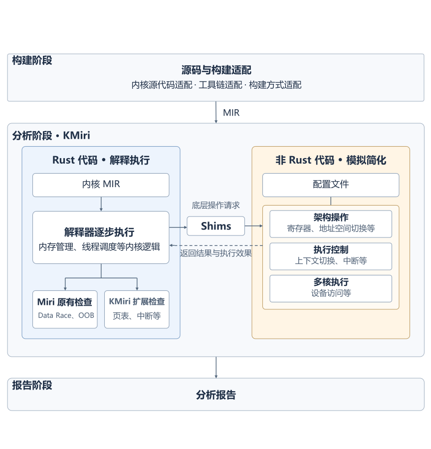

# 系统总览

## 定位

KMiri 是基于 Miri 的 Rust 内核执行与检查环境：为选定的内核操作提供解释器能够理解的执行语义，并检查相关 Rust 执行中的未定义行为。

## 组件构成

* kmiri：基于 Miri 的解释器扩展，负责内核执行环境与原有检查机制的对接。
* MIR Debugger：交互式调试工具，用于观察 MIR 执行位置、调用栈、内存对象和检查状态，辅助分析执行过程及错误原因。

## 架构概览

构建阶段完成内核源代码适配、工具链适配和构建方式适配，生成供 KMiri 解释执行的 MIR。

分析阶段中，解释器逐步执行内核 MIR，包括内存管理、线程调度等 Rust 逻辑，并在执行过程中进行 Miri 原有检查与 KMiri 扩展检查。遇到底层操作时，通过 Shims 接入非 Rust 操作的模拟或简化实现；配置文件提供环境参数和行为配置。虚线箭头表示将返回结果与执行效果补充到 Rust 执行中。

报告阶段输出分析报告。

## Rust 内核适配路线图

r[overview.adaptation]

各内核的接入范围如下。源码基线与实际运行版本分别记录，不将编译、接口接入和运行验证混为同一成果。

| Rust 内核 | 宏内核/微内核 | 适配目标 | 现有成果 |
| --- | --- | --- | --- |
| 星绽（Asterinas） | **[Framekernel（框架内核）](https://github.com/KMiri-rs/asterinas/blob/e255c1ed5550dc2965c535c824f17f9f353fc31e/README.md#L60-L66)** | 页分配与回收、映射更新、任务调度、每 CPU 数据、中断与多核。 | 已对接页事件、根页表与任务切换；[init 用例](https://github.com/KMiri-rs/KMiri/blob/33963c7ebde744f52657d4205b39e42a9bbefd23/tests/init/src/lib.rs#L7-L19)包含任务创建和让出。页释放通知仍有缺口；当前[仅启用一个 CPU](https://github.com/KMiri-rs/asterinas/blob/e255c1ed5550dc2965c535c824f17f9f353fc31e/ostd/src/arch/miri/boot/smp.rs#L6-L12)。 |
| TockOS | **[微内核](https://github.com/tock/book/blob/760025b0d8a1d5ff14d6015c1c50ac4e30490923/src/doc/overview.md#L9-L27)** | 板级初始化、进程调度、系统调用、中断与内存保护。 | 已有 [Miri 入口](https://github.com/KMiri-rs/tock/blob/b07f8a811d7fc6317f6a77ea0b066d8ecf80134c/boards/qemu_rv64_virt/src/main.rs#L163-L176)和[无分页配置](https://github.com/KMiri-rs/tock/blob/b07f8a811d7fc6317f6a77ea0b066d8ecf80134c/boards/qemu_rv64_virt/kmiri.toml#L1-L20)；已运行初始化与十轮无中断主循环，以主动 panic 结束。 |
| BlueOS | 待确认（[官方资料](https://github.com/KMiri-rs/vivoblueos-kernel/blob/8ff38027d595c29323c759aa6ae244437bf48292/README.md#L5-L27)未明确宏／微分类） | 原初始化、分配器、调度与同步；真实上下文切换、中断与多核。 | 已有 GN 构建及[启动适配](https://github.com/KMiri-rs/vivoblueos-kernel/blob/8ff38027d595c29323c759aa6ae244437bf48292/kernel/src/miri_boot.rs#L74-L92)；已有原初始化、十轮空闲调度、正常退出的运行记录，限单核，无真实上下文切换。 |

源码基线

KMiri 总仓库：`33963c7ebde744f52657d4205b39e42a9bbefd23`；解释器：`af87bdb338e347872bc2429308e2865901488bfb`；星绽：`e255c1ed5550dc2965c535c824f17f9f353fc31e`；TockOS：`b07f8a811d7fc6317f6a77ea0b066d8ecf80134c`。

BlueOS 按 [snapshot.xml](https://github.com/KMiri-rs/KMiri/blob/33963c7ebde744f52657d4205b39e42a9bbefd23/vivo-blueos/snapshot.xml#L8-L20) 固定为 kernel `8ff38027d595c29323c759aa6ae244437bf48292`、build `7051c5eebc574c9ff3013c962af253ebf55e174c`。

构建入口与版本依据：

* **星绽**：在上述基线安装解释器与 OSDK 后，从 `tests/init` 执行 `OSDK_LOCAL_DEV=1 cargo osdk miri test`，见[运行步骤](https://github.com/KMiri-rs/KMiri/blob/33963c7ebde744f52657d4205b39e42a9bbefd23/README.md#L82-L94)。后续 ktest 的通过与失败记录见 [discussion #260](https://github.com/KMiri-rs/KMiri/discussions/260)；页释放通知修复见 [asterinas#27](https://github.com/KMiri-rs/asterinas/pull/27)，尚未计入本基线。
* **TockOS**：从总仓库执行 `make -C tock/boards/qemu_rv64_virt` 编译板级内核，见[构建目标](https://github.com/KMiri-rs/tock/blob/b07f8a811d7fc6317f6a77ea0b066d8ecf80134c/boards/Makefile.common#L245-L265)；[目标配置](https://github.com/KMiri-rs/tock/blob/b07f8a811d7fc6317f6a77ea0b066d8ecf80134c/boards/qemu_rv64_virt/.cargo/config.toml#L5-L12)为 `riscv64imac-unknown-none-elf`，入口为 `miri_start`。适配 [PR #10](https://github.com/KMiri-rs/tock/pull/10) 的源提交即基线 `b07f8a8…`，合并提交为 `94bbfeb55979d65d0b49018ca72d5f9307a744c7`；其中记录了初始化与无中断主循环执行，最终因主动 panic 而 abort，并非退出 0。
* **BlueOS**：从 `vivo-blueos` 执行 `make miri_boot`，其[构建目标](https://github.com/KMiri-rs/KMiri/blob/33963c7ebde744f52657d4205b39e42a9bbefd23/vivo-blueos/Makefile#L132-L172)先生成带 MIR 的依赖，再复用 GN 编译参数解释内核；另有[基础库／分配器测试](https://github.com/KMiri-rs/KMiri/blob/33963c7ebde744f52657d4205b39e42a9bbefd23/vivo-blueos/Makefile#L110-L125)与[内核测试](https://github.com/KMiri-rs/KMiri/blob/33963c7ebde744f52657d4205b39e42a9bbefd23/vivo-blueos/Makefile#L176-L185)入口。后续 [kernel PR #17](https://github.com/KMiri-rs/vivoblueos-kernel/pull/17) 记录的 10 月 11 日验证使用 kernel `db2c9c446c36e09fe7fe7362561bf8fde7e21f18`、build `2f4ef597da6e6547fcd52bfddce8eb49a12a46c5`：原初始化、十轮 idle、`BLUEOS_MIRI_DONE`，解释器退出 0。这是配套依赖和工具链下的 GN action 验证，不是对上述 snapshot 组合的重新验证；未覆盖应用、真实上下文切换、硬件中断投递或 SMP。

页表路径只适用于启用分页的内核；无分页或 MPU 配置按各自的地址访问与内存保护机制适配。内存、页表与执行模型见[核心设计](core-design.md#r-core.approach)。

## 外部集成关系

[说明与 Asterinas / OSDK / Rust nightly / 测试工程之间的关系和边界。]
