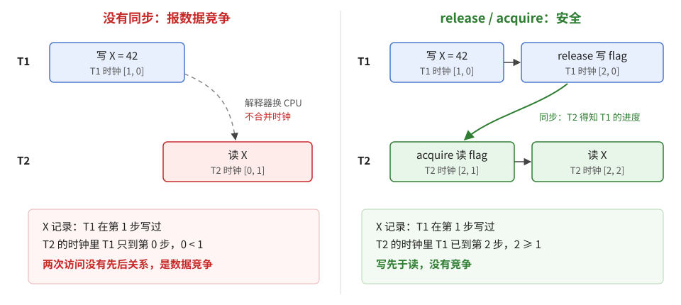
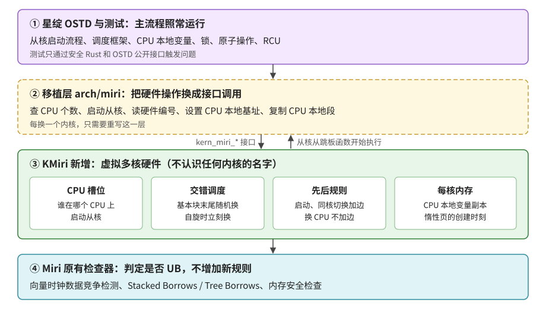
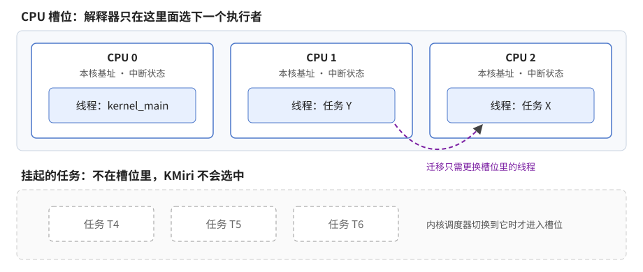
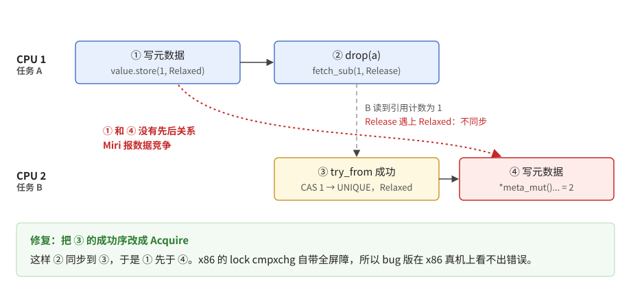

# 多核并发检测的整体设计与进展

本文说明 KMiri 怎样在一个解释器里模拟多个 CPU，并检查只有多核并发才会出现的未定义行为（UB）。读完后你应该能回答四个问题：为什么一次只执行一个 CPU 也能查出多核数据竞争；KMiri 为此加了什么；它已经查出了什么；它现在还查不了什么。

- 阅读本文需要知道 Rust 的 `Send` / `Sync` 和原子操作的基本含义，不需要了解 Miri 内部实现。
- 本文描述已经合入主线的实现，代码版本为 [KMiri `8e8535d`](https://github.com/KMiri-rs/KMiri/tree/8e8535dd21c12139f64c4aa1841b359334249e69)、[miri `c20899d`](https://github.com/KMiri-rs/miri/tree/c20899ddcc1b63741c8569dc0d78dcb68d4199f8)、[asterinas `9226ec3`](https://github.com/KMiri-rs/asterinas/tree/9226ec3ae9482843d15db5a6fcc9838d54353766)。内容截至 2026-11-24。
- 目标内核是星绽（Asterinas）的内核框架 OSTD。中断部分见[中断机制的整体设计与进展](../interrupt/v2.md)。

## 先看结论

- **做法：** 一个 Miri 实例模拟整台机器。任一时刻只执行一个 CPU，在基本块末尾随机换到另一个 CPU，自旋等待时立刻换。
- **判定：** 是不是数据竞争仍由 Miri 原有的检查器判断，KMiri 没有增加新的 UB 规则。
- **成果：** 查出并确认了 3 个星绽上游的新问题，修复都已合入上游；另外检出 3 个历史 bug 和 1 个同类注入的 bug。
- **边界：** 处理器间中断（IPI）、CPU 真正停机（halt）、每个 CPU 自己的定时器和 TLB 都还没有建模。随机交错不保证找全，所以“没报错”不等于“没有并发 bug”。

## 为什么需要多核模型

看一个简化的例子。两个任务分别在两个 CPU 上，对同一个 `Cell<u64>` 加一：

```rust
// 任务 X，运行在 CPU 2
cell.set(cell.get() + 1);

// 任务 Y，运行在 CPU 1
cell.set(cell.get() + 1);
```

`Cell` 不能被多个线程同时访问，所以这是数据竞争，属于语言级 UB。如果安全代码能写出这段程序，就说明 OSTD 的安全接口有漏洞。

改造前的 KMiri 只模拟一个 CPU。两个任务只能在 CPU 0 上轮流运行，而同一 CPU 上的任务切换本身就有先后顺序，上面的竞争不存在。Miri 的检查器能识别这类 UB，只是这条执行路径根本走不到。

普通 Miri 虽然支持多线程，却不能直接拿来跑内核：

| 内核需要什么 | 普通 Miri 的情况 |
| --- | --- |
| 被调度器挂起的任务不能自己运行 | 不懂内核的等待队列，遇到自旋时可能挑中一个挂起的任务运行，产生假 UB |
| 区分“同一 CPU 上切任务”和“两个 CPU 并行” | 只有线程，没有 CPU 的概念 |
| 每个 CPU 有自己的一份 CPU 本地变量和中断开关 | 没有这些状态 |
| 按内核自己的流程启动其他 CPU | 线程只能由 `std::thread` 创建 |

所以 KMiri 要补的不是检查规则，而是**让这些执行能够发生的机器模型**。

## 目标与范围

| 维度 | 选择 | 原因 |
| --- | --- | --- |
| 检测什么 | 只有多 CPU 并发才会发生的语言级 UB，主要是数据竞争，也包括由此引起的释放后使用和别名违规 | 这些是 Miri 本来能判定、只是跑不到的问题 |
| 谁判定 UB | Miri 原有的数据竞争检测、Stacked Borrows / Tree Borrows 和内存安全检查 | 判定标准来自 Rust 语义，不由 KMiri 定义 |
| 优先保证什么 | 报出来的问题要真实，不追求找全 | 误报会破坏结果的可信度；漏报可以靠更多种子和更好的调度策略逐步减少 |
| CPU 数量 | 可配置，默认 1 | 不打开多核时，原有单核测试的运行方式不变 |
| 内核范围 | x86-64 语义下的 OSTD，只跑内核态 | 与中断第一版的边界一致 |
| 通用性 | 解释器只提供“启动 CPU”这类通用接口，星绽专属逻辑放在移植层 | 换一个 Rust 内核时只需重写移植层 |

## 核心原理：为什么一次跑一个 CPU 也能查竞争

直觉上，两个访问必须“同时发生”才算竞争。但 Rust 的内存模型不看物理时间，只看**两次访问之间有没有同步建立的先后关系**（happens-before）。只要两次访问指向同一内存、至少一次是写、至少一次不是原子操作，并且彼此没有先后关系，就是数据竞争。

Miri 用**向量时钟**记录这种关系。每个线程保存一个数组，第 `j` 项表示“我已经知道线程 `j` 做到了第几步”。每块内存记录最近一次访问是谁在第几步做的。新的访问到来时，Miri 检查当前线程是否已经知道那一步。



左边，T1 写完 `X` 后没有任何同步，T2 的时钟不知道 T1 的第 1 步，所以报竞争。即使两次访问在解释器里隔了几千步，结果也一样。右边，T1 用 release 写标志，T2 用 acquire 读到它，T1 的进度就传给了 T2，之后读 `X` 是安全的。

由此得到整个设计最重要的一条规则：

> **换 CPU 这个动作本身不建立先后关系。** CPU 之间的先后关系只能来自内核真实执行的同步操作。

如果每次换 CPU 都合并时钟，解释器就替内核补上了并不存在的同步，所有跨 CPU 的竞争都会被掩盖。

交错执行的代价在于**覆盖率**。一次运行只走一种交错，有的 bug 需要特定的执行顺序才会出现，所以 KMiri 要用多个随机种子来运行。

## 整体结构

KMiri 的多核支持沿用中断支持的分层方式：内核主流程照常运行，移植层把硬件操作换成接口调用，KMiri 在解释器里扮演多核硬件，UB 仍由 Miri 判定。



内核和 KMiri 之间的接口很小，每个接口对应一个硬件操作：

| 接口 | 对应的硬件操作 | 行为 |
| --- | --- | --- |
| `kern_miri_cpu_count` | 从固件 ACPI 表读取处理器个数 | 返回配置的 CPU 数 |
| `kern_miri_current_cpu` | 读本核 APIC ID | 返回当前 CPU 的硬件编号 |
| `kern_miri_start_cpu` | 发 INIT-SIPI-SIPI 唤醒从核 | 让指定 CPU 在给定的栈上执行入口函数，此时中断关闭 |
| `kern_miri_copy_cpu_local_section` | 按字节复制 `.cpu_local` 段 | 为从核建立一份 CPU 本地变量副本 |
| `kern_miri_set_cpu_local_base` / `kern_miri_get_cpu_local_base` | 写 / 读 GS 基址寄存器 | 按 CPU 保存基址 |
| `miri_switch_to` | 上下文切换 | 在当前 CPU 上换一个任务 |

这些接口不包含任何星绽的名字。星绽一侧的主要改动是 `arch/miri` 下的移植代码，另有 `copy_bsp_for_ap` 里的两处 `cfg(miri)`，见[局限](#局限)。

## CPU 是槽位，任务是线程

KMiri 把“谁在干活”和“在哪里干活”分开：

- **Miri 线程是执行上下文。** 主核启动流程、每个从核的启动流程、每个内核任务各是一个线程，有自己的调用栈和向量时钟。
- **CPU 是槽位。** 每个 CPU 记录“此刻哪个线程坐在我这里”，还带有本核的 CPU 本地基址和中断状态。



这样分层后，几个问题都变简单了：

- **任务迁移**只需要把线程放进另一个 CPU 的槽位，不用搬动调用栈。
- **挂起的任务不会被误唤醒。** KMiri 只在槽位里的线程之间切换，不在任何槽位里的任务不可能自己运行。
- **同一个任务不会同时跑在两个 CPU 上。** 内核如果切换到另一个 CPU 正在运行的任务，KMiri 会中止并报告。

## 什么时候换 CPU

KMiri 一次只执行一个 CPU。发生下面的事件时，执行权才转移：

| 事件 | 行为 | 是否建立先后关系 |
| --- | --- | --- |
| 基本块末尾 | 以 `switch_rate` 的概率（默认 1%）随机换到另一个可运行的 CPU | 否 |
| 自旋等待（`spin_loop`） | 立刻随机换到另一个可运行的 CPU；没有别的 CPU 时继续执行 | 否 |
| 内核切换任务（`miri_switch_to`） | 当前 CPU 换一个线程，其他 CPU 不变 | **是**，同一 CPU 上先跑的先于后跑的 |
| 启动从核（`kern_miri_start_cpu`） | 新 CPU 进入可运行状态，等被选中后才开始执行 | **是**，启动者之前的操作先于新 CPU 的第一步 |
| 中断处理期间 | 本 CPU 不换任务，但其他 CPU 可以继续运行 | 中断处理函数和被打断的代码在同一线程上 |

基本块是 MIR 里一段没有分支的语句序列。函数调用和原子操作都会结束一个基本块，所以每个原子操作之后都有机会换 CPU。

自旋时必须换 CPU，原因是自旋的 CPU 在等别的 CPU 做事。如果继续执行自己，就会一直空转；如果交给 Miri 通用调度器，又可能选中挂起的任务。我们在单核上实测过后一种情况：5 个种子全部报出假 UB。

随机选择使用独立的随机流，由配置里的 `[smp].seed` 控制。固定内核版本、配置和种子，就能重现同一次交错。

## 从核怎样启动

真实 x86 上，主核（BSP）通过 APIC 唤醒从核（AP）。从核执行汇编 `ap_boot.S`，从 16 位模式一路切到 64 位，领取 CPU 号，设置栈和 GS 基址，再进入 Rust 函数 `ap_early_entry`。

Miri 不能解释这段汇编，而且模式切换和 Rust 内存语义无关，所以 KMiri 从 64 位 Rust 代码开始：

1. BSP 运行 OSTD 原有的 `boot_all_aps`，准备启动栈和 CPU 本地副本。
2. 移植层调用 `kern_miri_start_cpu`，让从核从 Rust 跳板函数 `ap_trampoline` 开始。
3. 跳板用原子加法领取 CPU 号，设置 CPU 本地基址，然后调用 OSTD 原有的 `ap_early_entry`。
4. BSP 在 `wait_for_all_aps_started` 里自旋。每次自旋都会换到别的 CPU，从核因此得以执行。

有一个小差异：真实硬件先领号再取对应的栈，而 KMiri 的 CPU 启动时就要有栈，所以按硬件编号分配栈。每条栈仍然只给一个从核使用。

## CPU 本地变量

`cpu_local!` 定义的变量每个 CPU 各有一份。OSTD 启动时把主核的 `.cpu_local` 段按字节复制给每个从核，访问时用“本核基址 + 变量偏移”算出地址。

这在 KMiri 里不能直接照搬。Miri 把每个变量当作独立对象，分别跟踪边界、指针来源、借用状态和竞争状态，一次字节复制无法跨越多个对象。

KMiri 提供的复制接口效果等同于字节复制，但副本里的每个变量仍是独立对象：

- 已经被访问过的变量立刻复制，保留其中指针的来源。
- 还没被访问过的变量在第一次使用时创建，值取初值，创建时刻记为复制的那一刻。
- 变量之间的空隙不属于任何对象，访问它们会报悬垂指针。

此外，KMiri 删除了旧版本里“`.cpu_local` 段不查数据竞争”的豁免，否则 CPU 0 那份变量上的跨核竞争不会被报告。

## 惰性页的创建时刻

KMiri 的页被定型（例如定型为 slab 或页表）后，页里的对象要到第一次被访问时才真正创建。而 Miri 把“创建对象”当作一次写。单核时这没有影响，多核时如果把“第一个碰到它的线程”当作创建者，判定在两个方向上都会出错：

- **误报：** 发布者用 release 正确发布页后，自己才第一次访问对象，创建时刻就落到了发布之后。读者通过 acquire 正确同步，仍会被报竞争。
- **漏报：** 发布者忘了同步，但读者抢先访问对象，读者自己成了“创建者”，本该报告的竞争消失了。

修法是记录页的**定型时刻**，之后惰性创建的对象都以这一时刻为创建时刻。

## 走一遍：一个 x86 真机测不出的 bug

[asterinas#4270](https://github.com/asterinas/asterinas/issues/4270) 能很好地展示这套机制的价值。

星绽的物理页句柄 `Frame<M>` 类似 `Arc<M>`。`UniqueFrame::try_from` 类似 `Arc::try_unwrap`：当引用计数只剩 1 时，把共享句柄升级成独占句柄，之后可以通过 `meta_mut()` 拿到 `&mut M`。

要让独占访问合法，前任持有者的所有修改都必须先于新持有者的访问。`Frame::drop` 用 release 减引用计数，`try_from` 本应用 acquire 与之配对，实际却用了 `Relaxed`：

```rust
// 任务 A，运行在 CPU 1
a.meta().value.store(1, Ordering::Relaxed);
drop(a); // 内部：fetch_sub(1, Release)

// 任务 B，运行在 CPU 2
let mut unique = loop {
    match UniqueFrame::try_from(frame) { // 内部：Relaxed CAS，缺少 Acquire
        Ok(u) => break u,
        Err(back) => { frame = back; spin_loop(); }
    }
};
*unique.meta_mut().value.get_mut() = 2; // 与 A 的写没有先后关系
```



这段代码只用了安全 Rust 和 OSTD 的公开接口。检测过程用到了前面的每一部分：

1. 配置 3 个 CPU，OSTD 按原有流程启动从核，A 和 B 分别固定在 CPU 1 和 CPU 2。
2. B 拿不到独占权时调用 `spin_loop()`，KMiri 换到别的 CPU，A 才有机会写元数据并释放句柄。
3. B 看到引用计数变成 1，CAS 成功。因为换 CPU 不加先后关系，而 `Relaxed` 也不建立同步，B 的时钟里没有 A 的写。
4. B 通过 `meta_mut()` 访问元数据，Miri 报出数据竞争。

报告的关键部分如下：

```text
error: Undefined Behavior: Data race detected
between (1) atomic store on thread `unnamed-3`
and (2) retag read of type `Meta` on thread `unnamed-6`
  --> ostd/src/mm/frame/unique.rs:54:18
   |
54 |   unsafe { &mut *self.slot().as_meta_ptr::<M>() }
   |            ^^^^^^^^^^^^^^^^^^^^^^^^^^^^^^^^^^^^ (2) just happened here
```

报告里的 `unnamed-3` 是 Miri 线程名，对应一个任务，而不是某个 CPU，因为任务可以迁移。

这个 bug 有两点值得注意：

- **x86 真机看不出来。** `compare_exchange` 在 x86 上编译成 `lock cmpxchg`，硬件自带全屏障，碰巧掩盖了错误的内存序。KMiri 按 Rust 内存模型判定，不受硬件掩盖。
- **单核 KMiri 也看不出来。** 单核时 A 和 B 只能经过任务切换轮流运行，切换带来的先后关系同样会掩盖这个问题。

KMiri 的结果：bug 版 15 次运行全部报竞争，两组对照各 15 次全部干净。关闭借用模型后再跑 5 次，仍然全部报在普通写上，说明它不是借用模型过严造成的。修复只需把这次 CAS 的成功序改成 `Acquire`。

## 怎样运行

在内核测试的 `kmiri.toml` 里加上 `[smp]` 段：

```toml
[smp]
num_cpus = 3        # CPU 个数，默认 1
switch_rate = 0.01  # 基本块末尾换 CPU 的概率，默认 0.01
seed = 0            # CPU 交错的随机种子，默认 0
```

在 KMiri 仓库根目录运行主线自带的多核测试。`smp-ap-tasks` 是应当通过的对照，`smp-data-race` 应当报出数据竞争：

```bash
make -C kmiri asterinas ASTERINAS_TEST=smp-ap-tasks
make -C kmiri asterinas ASTERINAS_TEST=smp-data-race
```

如果内核的 CPU 本地段超过默认的 64 KiB，KMiri 会报错并给出需要的大小，在 `kmiri.toml` 顶层设置 `cpu_local_size` 即可。

写多核测试时有两点要注意：

- 星绽默认的 FIFO 调度器把任务都放到主核。要让任务跑在从核上，需要通过公开接口 `inject_scheduler` 注入一个能指定 CPU 的调度器，可参考 `tests/smp-ap-tasks/src/pin_sched.rs`。
- 在竞争代码之前加一个**会合点**，等两边都到达后再开始访问。否则后到的任务可能通过堆分配器的锁继承先到任务的时钟，两边被排出先后，竞争就不会被报告。

## 验证结果

### 查出的上游新问题

下面 3 个问题都只用安全 Rust 和 OSTD 公开接口触发，已报告给星绽上游，修复均已合并。线索来自 AI 辅助的代码审计，KMiri 负责实际执行并确认，所以它们不是 KMiri 自动搜索出来的。KMiri 运行时使用带移植层的星绽分支。

| 问题 | 根因和后果 | KMiri 检出 | 真机情况 | 修复 |
| --- | --- | --- | --- | --- |
| [#4265](https://github.com/asterinas/asterinas/issues/4265) | `CpuLocalCell<T>` 实现 `Sync` 时没有要求 `T: Send`，`&Cell<u64>` 可以传给另一个 CPU 上的任务，造成数据竞争 | 15/15 | QEMU/KVM 3 核跑 3 次都丢更新，期望 200 万，少了约 46 万到 53 万 | [#4269](https://github.com/asterinas/asterinas/pull/4269) |
| [#4270](https://github.com/asterinas/asterinas/issues/4270) | `UniqueFrame::try_from` 的 CAS 用了 `Relaxed`，造成数据竞争 | 15/15 | x86 上看不出 | [#4278](https://github.com/asterinas/asterinas/pull/4278) |
| [#4271](https://github.com/asterinas/asterinas/issues/4271) | `cpu_local!` 变量对齐超过 4 KiB 时，从核副本只按页对齐，造成未对齐引用 | 15/15 | QEMU 上 `is_aligned()` 为 false | [#4279](https://github.com/asterinas/asterinas/pull/4279) |

“KMiri 检出”一栏是报出该问题的运行次数 / 总运行次数，这些运行覆盖不同的随机种子和借用模型。#4265 的对照 15 次全部干净，#4270 的两组对照各 15 次全部干净。

### 历史案例

我们把已知需要多核的 8 个案例逐个评估，5 个能检出（包括上表的 #4265），3 个没有运行。每个检出的案例都有同布局的对照。

| 案例 | 问题 | CPU 数 | bug 版 | 对照 |
| --- | --- | --- | --- | --- |
| [#3891](https://github.com/asterinas/asterinas/issues/3891) | 关中断 / 关抢占 guard 可被共享，在别的 CPU 上被当作“已钉在当前 CPU”的凭证 | 3 | 20 次全报 | 20 次干净 |
| [#3909](https://github.com/asterinas/asterinas/issues/3909) | 锁 guard 的 `Sync` 没有检查内层 guard | 2 | 15 次全报 | 15 次干净 |
| [#3892](https://github.com/asterinas/asterinas/issues/3892) 的多核部分 | 空 `Segment` 保留原帧地址，与另一个 CPU 复用该帧时竞争 | 2 | 15 次全报 | 15 次干净 |
| [#1822](https://github.com/asterinas/asterinas/issues/1822)（同类注入） | 页表项的无锁读和加锁写退回普通读写 | 3 | 15 次全报 | 主线原子版 15 次干净 |

#1822 不是历史 bug 的原样复现。原修复无法干净撤销，所以我们在今天的代码上把页表项的原子读写改回普通读写，它证明的是“这一类问题能检出”。

没有运行的 3 个案例：[#1274](https://github.com/asterinas/asterinas/issues/1274) 需要完整内核和文件系统；[#3893](https://github.com/asterinas/asterinas/issues/3893) 已被维护者否定，不算语言级 UB；另一个是 RISC-V 上的 DMA 同步问题，超出当前 x86 范围。

### 误报回归

我们在 45 个内核测试上比较了 1、2、3 个 CPU，并分别使用 Stacked Borrows 和 Tree Borrows（实验日期 2026-11-21）：

- 单核时干净的测试，在多核下没有一个报 UB，即误报为 0。
- 2、3 核下，39 个测试的判定与单核相同。另外 6 个 RCU 测试 panic，提示宽限期没有结束。
- 这 6 个测试的原因是：RCU 宽限期要求每个 CPU 都切换过任务，而默认调度器不往从核放任务。给每个从核固定 2 个任务后，6 个测试在 2、3 核和 3 个种子下共 36 次运行，结果都与单核相同。这一原因来自读代码，没有在真机多核上单独验证。

主线 CI 持续运行 3 个内核级多核测试（`smp-ap-tasks`、`smp-ap-task-returns`、`smp-data-race`）。解释器一侧有 19 个小型 UI 测试，其中 12 个应当通过，7 个应当报错，分别覆盖误报和漏报两个方向。

## 局限

**没有建模的硬件：**

| 项目 | 现在的行为 | 影响 |
| --- | --- | --- |
| 处理器间中断（IPI） | `send_ipi` 是空函数 | 跨 CPU 调用不会执行，依赖它的等待可能卡住 |
| halt | 只开中断，立刻返回 | 空闲循环变成忙等，不影响竞争判定 |
| 每 CPU 定时器 | 只有一条全局定时器，从核没有自己的时钟中断 | 依赖从核时钟和抢占的路径走不到 |
| TLB 与每 CPU 页表根 | 没有 TLB 模型，全机一个页表根，刷新为空操作 | 查不到“忘记刷 TLB”这类问题 |

**检测能力的边界：**

- **只会走到一部分交错。** 切换只发生在基本块末尾，并且是随机抽样。这可能造成漏报，所以没报错不代表没有 bug。
- **弱内存没有专门评估。** Miri 的弱内存模拟默认开启，按 Rust 内存模型判定。`Relaxed` 读可能读到 x86 上读不到的值，从而走到 x86 上走不到的路径。按语言级 UB 的标准这是合理的，但我们还没有做开关弱内存的对比实验。
- **仍有理论上的误报来源。** 开机时定型的 3 页启动页表还是按首次访问记录创建时刻；从核领号用 `Relaxed`，比真实硬件的 `lock xadd` 弱。目前的运行都没有因此报错。
- **多核运行结束时不查内存泄漏。** 关机时从核通常还在运行，它们的栈仍然有效，所以跳过了这项检查。泄漏本身也不是 UB。
- **OSTD 里还有两处 `cfg(miri)`。** 它们在 `copy_bsp_for_ap` 里，用来把地址表页定型并调用按变量复制的接口。复制结果在 Rust 语义上相同，但确实改动了内核组件的代码，以后希望去掉。
- **完整内核还没有在主线上以多核运行。** 上面的结果来自 OSTD 测试内核。完整内核的支持还在合并中。

## 下一步

1. **完整内核多核运行。** 先合入完整内核的支持，再在多核下运行，之后才能处理 #1274 这类依赖文件系统的案例。
2. **提高交错覆盖。** 量化每个案例需要多少种子才能触发，尝试有偏调度（例如 PCT，按优先级切换线程），减少测试对手写会合点的依赖。
3. **评估弱内存的影响。** 对现有案例做一组开关弱内存的对比。
4. **IPI 和 halt 等真实案例。** 我们要求新的硬件建模先有真实的动机案例。目前在星绽 IPI / halt 路径的排查范围内，只找到活性问题和硬件 TLB 层面的问题，没有找到语言级 UB 案例，所以暂缓实现。

<details>
<summary>相关源码</summary>

* 配置：[`[smp]` 段](https://github.com/KMiri-rs/miri/blob/c20899ddcc1b63741c8569dc0d78dcb68d4199f8/src/mirch/config_toml.rs#L56-L69)
* 换 CPU：[基本块末尾随机换和自旋换](https://github.com/KMiri-rs/miri/blob/c20899ddcc1b63741c8569dc0d78dcb68d4199f8/src/concurrency/thread.rs#L1478-L1502)、[调度入口](https://github.com/KMiri-rs/miri/blob/c20899ddcc1b63741c8569dc0d78dcb68d4199f8/src/concurrency/scheduler.rs)
* 先后关系：[同一 CPU 上切换任务](https://github.com/KMiri-rs/miri/blob/c20899ddcc1b63741c8569dc0d78dcb68d4199f8/src/concurrency/data_race.rs#L1952)
* 接口：[启动 CPU](https://github.com/KMiri-rs/miri/blob/c20899ddcc1b63741c8569dc0d78dcb68d4199f8/src/shims/foreign_items.rs#L1122)、[复制 CPU 本地段](https://github.com/KMiri-rs/miri/blob/c20899ddcc1b63741c8569dc0d78dcb68d4199f8/src/alloc_addresses/mod.rs#L762)
* 星绽移植层：[从核启动](https://github.com/KMiri-rs/asterinas/blob/9226ec3ae9482843d15db5a6fcc9838d54353766/ostd/src/arch/miri/boot/smp.rs)、[CPU 本地段复制](https://github.com/KMiri-rs/asterinas/blob/9226ec3ae9482843d15db5a6fcc9838d54353766/ostd/src/cpu/local/mod.rs#L230-L271)
* 测试：[解释器 UI 测试（`smp-*`）](https://github.com/KMiri-rs/miri/tree/c20899ddcc1b63741c8569dc0d78dcb68d4199f8/tests/pass/kmiri)、[内核测试 `smp-data-race`](https://github.com/KMiri-rs/KMiri/tree/8e8535dd21c12139f64c4aa1841b359334249e69/tests/smp-data-race)

</details>
